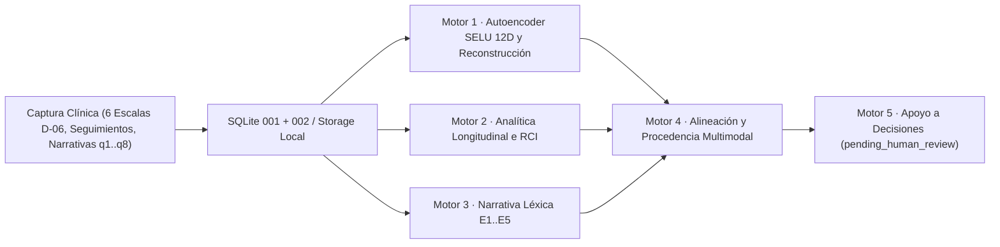

# E · Arquitectura de la Plataforma de Inteligencia SISAP (5 Motores)

SISAP evoluciona desde un sistema de captura y gobierno de datos hacia una arquitectura de inteligencia modular en cinco motores interconectados, manteniendo trazabilidad auditable (`WORM` + `model_runs` + `clinical_formulations`) y control humano obligatorio.

---

## 1. Vista Panorámica del Flujo Computacional

---

## 2. Descripción Técnica de los 5 Motores

1. **Motor 1 — Autoencoder y Representación Latente (`autoencoderService.js` + `autoencoderInferenceEngine.js` + `latentSpaceAnalyzer.js`):**
   - Implementa el pipeline exacto de 5 capas: validación `D-06` sin imputación, scoring `BIS-11 / BADS / EROS / GAD-7 / STAXI-2 (49) / BSL-23 (23+11+GENERAL)`, derivados Nivel 2B, Winsorización `[q01, q99]` + Z-score con parámetros fijos `N=166`, y pase hacia adelante `Encoder + Decoder SELU`.
   - Expone `encoder_22_checkpoint_fase2` (definitivo) y `encoder_24_deployed` con verificación SHA-256 y comparación geométrica contra percentiles `p05..p95` (`LatentIntervalChart`) y residuos `(X_z - Xhat_z)^2` (`ReconstructionBarsChart`).
   - Restricción `MOD-03`: dimensiones `latent_01..12` opacas, sin clustering GMM (`D-03`).

2. **Motor 2 — Inteligencia Analítica Longitudinal (`analyticalService.js` + `FollowUpScalesView.tsx`):**
   - Captura e integra series temporales de `GAD-7`, `BADS`, `EROS`, `BSCS`, `PSS-4`, `SHAPS`, `UCLA-3`, combinando línea base (`T0`) con `follow_up_evaluations` (`S1..Sn`).
   - Calcula deltas intraindividuales, pendientes por sesión e **Índice de Cambio Confiable (Jacobson-Truax RCI)** únicamente para instrumentos con `SD` y `r_xx` documentados (`GAD-7`, `BSL-23`, `EROS`, `BADS`); declara explícitamente `NOT_APPLICABLE` o `INSUFFICIENT_OBSERVATIONS` cuando faltan datos.

3. **Motor 3 — Inteligencia Narrativa y Conductual (`narrativeService.js`):**
   - Inspecciona en tiempo real el artefacto ONNX `bsc-bio-ehr-es/modelo.onnx` reportando con honestidad que la inferencia neuronal está inactiva.
   - Ejecuta extracción léxico-funcional determinista sobre `weekly_observations` (`q1..q8`) y notas clínicas de evolución en dominios de proceso (`craving_impulso`, `evitacion_experiencial`, `disregulacion_afectiva`, `activacion_afrontamiento`), calculando riqueza léxica (`type-token ratio`) y clasificando todo hallazgo con evidencia `E1_explicit` / `E3_observational` / `E5_insufficient` y `review_status = 'pending_human_review'`.

4. **Motor 4 — Integración Multimodal (`multimodalService.js`):**
   - Fusiona las 5 fuentes de información por expediente en una matriz alineada preservando **tabla de origen, temporalidad, granularidad, completitud y bandera de calidad**, manteniendo `EROS_raw` aislado de `tiempo_consumo`.

5. **Motor 5 — Apoyo a Decisiones Basadas en Evidencia (`decisionSupportService.js` + `IntelligenceEcosystemView.tsx`):**
   - Agrega hallazgos `E1..E5`, incertidumbre empírica (`p25–p75`, `p05–p95`, `RMSE_z`, `|RCI|`), comparador geométrico entre perfiles latentes (distancia L2 y similitud coseno), compositor trazable de formulaciones (`POST /api/patients/:id/formulations`) y exportación Markdown/JSON.
   - Prohibición estricta a nivel de diseño y pruebas automatizadas (`MOT-02`): `automatic_diagnosis_disabled = true`, `therapeutic_prescription_disabled = true`.
