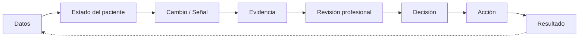

# SISAP by CENIVRA — Product Discovery README

> Estrategia de producto para la fase de descubrimiento (*discovery*) de SISAP by CENIVRA, la capa de apoyo a la decisión clínica (CDS) para el seguimiento longitudinal de pacientes en tratamiento residencial por trastornos por uso de sustancias (TUS).

- **Proyecto:** SISAP by CENIVRA
- **Institución:** Comunidad Terapéutica Under The Tree Potrerillos — Área de Psicología
- **Responsable:** Psic. Lauro Gutiérrez Castro
- **Estado técnico:** Migración R/Shiny → Python/Dash, Fase 2/14 (configuración, estructura, base de datos)
- **Este documento:** Fase de Product Discovery — se ejecuta en paralelo a la Fase 2/14, no la sustituye
- **Última actualización:** 2026-09-03

---

## Tabla de contenidos

1. Resumen ejecutivo
2. Visión del producto
3. El loop clínico: 4 momentos
4. User personas
5. Usuario primario: hipótesis
6. Plan de investigación UX/UI
7. Métricas de éxito
8. Fuera de alcance
9. Marco regulatorio y explicabilidad
10. Gobernanza de datos y privacidad
11. Integración con el desarrollo técnico en curso
12. Criterios de salida del Discovery Sprint
13. Sinergia con la agenda de investigación
14. Roadmap
15. Referencias

---

## 1. Resumen ejecutivo

Antes de seguir trabajando sobre la interfaz o el pitch comercial de SISAP by CENIVRA, conviene invertir tiempo en lo que se denomina **descubrimiento de producto**, es decir, entender quién usa cada función, en qué momento, con qué información puede contar y qué decisión necesita tomar cuando la consulte. En necesario aclarar tambien que **el software clínico no se valida por "que el usuario lo entienda", una parte importante consiste en reducir errores de uso previsibles mediante diseño, y por permitir que el profesional revise la base de cualquier recomendación en lugar de depender ciegamente de ella.**

La finalidad de este documento no es reemplazar el trabajo técnico que ya se encuentra en marcha (migración a Python/Dash, arquitectura de modelos, base de datos). Más bien su objetivo es complementar: mientras la infraestructura avanza, el Discovery Sprint debe responder  preguntassobre el producto que todavía no tienen respuesta y varias de esas respuestas deberían informar directamente decisiones de interfaz que aún no se han tomado.

## 2. Visión del producto

SISAP by CENIVRA no es otro expediente clínico electrónico (EHR) ni un dashboard lleno de gráficas. Es una **capa de inteligencia clínica sobre el flujo de trabajo que ya existe**.

Al entrar, el profesional debería poder responder las siguientes preguntas rápidamente:

- ¿Qué está pasando con este paciente?
- ¿Qué cambió?
- ¿Qué merece mi atención?
- ¿Por qué el sistema me lo está mostrando?
- ¿Qué información necesito revisar antes de decidir?

## 3. El loop clínico: 4 momentos

| Momento | Qué hace SISAP | Pregunta que responde |
|---|---|---|
| **1. Capturar** | Reúne lo que ya se genera en la atención: escalas, observaciones, narrativa, eventos clínicos, asistencia, evolución, variables conductuales, datos longitudinales | ¿Qué información ya existe? |
| **2. Organizar** | Convierte esos datos en estado actual, evolución, dimensiones, tendencias, señales | ¿Qué significan estos datos? |
| **3. Priorizar** | Identifica cambios relevantes respecto a la trayectoria del paciente y los presenta junto con la evidencia que los sostiene — no un veredicto ("el paciente tiene X"), sino una señal con evidencia ("este paciente presenta un cambio relevante respecto a su trayectoria reciente; revise estas dimensiones") | ¿Qué merece revisión ahora? |
| **4. Decidir** | El profesional revisa la evidencia y decide — human-in-the-loop | ¿Qué hacemos con esto? |

Es un ciclo, no una tubería lineal:

*(La flecha punteada de "Resultado" a "Datos" cierra el ciclo: el producto no debería mostrar solo un estado — debería ayudar a entender la transición entre estados.)*

Esto conecta directamente con el trabajo dimensional ya construido y reportado: las 12 dimensiones clínicas (Dim1–Dim12) y la arquitectura de encoder/autoencoder/GMM son, en este marco, el motor del momento "Organizar". El Discovery Sprint (sección 6) es la oportunidad de verificar si esas dimensiones, tal como están calculadas hoy, coinciden con lo que un clínico real considera "un cambio relevante".

## 4. User personas

Al menos cuatro personas de producto distintas — no una interfaz única para todas:

| Persona | Rol | Job-to-be-done | Su problema real |
|---|---|---|---|
| **1. Profesional clínico** | Psicólogo, psiquiatra o médico | "Necesito identificar rápido qué cambió en este paciente y qué debo revisar" | No es falta de datos — es exceso de datos + poco tiempo + información fragmentada |
| **2. Coordinador/director clínico** | Supervisión clínica | "¿Qué pacientes requieren revisión? ¿Está funcionando el tratamiento? ¿Qué pasa con la población?" | Necesita población, tendencias, alertas, retención, cumplimiento — no cada variable individual |
| **3. Dirección/administración** | Gestión operativa | Compra capacidad operativa + retención + trazabilidad + eficiencia, no "IA" | Necesita indicadores económicos: ocupación → abandonos → días de estancia → intervenciones → costos |
| **4. Paciente** | Beneficiario | — | No necesariamente usa el producto de forma directa (ver sección 9.2: esto es también una decisión regulatoria, no solo de UX) |

## 5. Usuario primario: hipótesis

> **Hipótesis inicial:** el psicólogo/terapeuta clínico en tratamiento residencial de TUS es el usuario primario. El paciente es el beneficiario. El director clínico y consejeros en adicciones son el usuario secundario. La dirección administrativa es compradora/decisora económica.

Esta es una hipótesis, no una conclusión, la Fase 1 deberia confirmarla o revisarla con evidencia, no darla por sentada.

## 6. Plan de investigación UX/UI

Antes de invertir en una agencia de UX grande, debemos diseñar un Product Discovery Sprint pequeño y acotado.

### 6.1 Fase 1 — Entrevistas contextuales

**5–8 profesionales clínicos**, de distintos perfiles y, si es posible, distintos centros. No preguntar "¿te gusta SISAP?" — preguntar:

- "Muéstrame cómo haces hoy una evaluación."
- "¿Dónde buscas esta información?"
- "¿Qué haces cuando sospechas que un paciente está empeorando?"
- "¿Cómo sabes quién necesita más atención?"
- "¿Cuánto tardas?"
- "¿Qué información te falta?"
- "¿Qué haces con una alerta?"

Como estímulo adicional, vale la pena mostrar las 12 dimensiones clínicas ya definidas y preguntar directamente cuáles resuenan con el juicio clínico real, de esta manera la entrevista puede convertirase en una validación del modelo existente, no solo en una exploración desde cero.

**Nota de gobernanza:** dado que estas entrevistas involucran a personal clínico y su contenido podría alimentar una publicación, conviene definir el consentimiento informado de la entrevista pensando también en ese uso secundario desde el principio.

### 6.2 Fase 2 — Journey map

Documentar: Ingreso → Evaluación → Tratamiento → Seguimiento → Detección de cambio → Revisión clínica → Intervención → Resultado.

Y preguntar en cada etapa: **¿dónde entra SISAP?** La hipótesis de partida es que no debería entrar en todas partes, probablemente su mayor valor está entre **seguimiento → detección → revisión clínica → intervención**.

### 6.3 Fase 3 — Prototipos de baja fidelidad

Sin programar todavía.

**Pantalla 1 — Pacientes que requieren revisión**

| Paciente | Cambio | Evidencia | Última revisión |
|---|---|---|---|
| P-023 | ↑ evitación | 3 mediciones | 2 días |
| P-041 | ↓ activación | 4 mediciones | 5 días |

**Pantalla 2 — Al abrir un paciente (P-023)**

¿Qué cambió? → ¿Desde cuándo? → ¿Qué variables lo explican? → ¿Qué evidencia respalda la señal? → ¿Qué decidió el profesional?

Esto es mucho más útil que un radar decorativo.

## 7. Métricas de éxito

### 7.1 Alert fatigue

Es el riesgo crítico: si SISAP genera alertas constantes, el profesional deja de mirarlas en pocas semanas. La pregunta de diseño correcta no es "¿cuántas alertas generamos?" sino **¿cuántas señales generadas realmente merecieron atención clínica?**

Una revisión sistemática de 2026 en JAMIA sobre medición de alert fatigue en sistemas de apoyo a la decisión clínica encontró que los criterios usados para definirlo son inconsistentes entre estudios, y recomendó usar como métrica operacional una caída sostenida y significativa en la tasa de respuesta apropiada a las alertas, medida contra una línea base establecida (Ray et al., 2026). En la misma línea, revisiones previas muestran que las alertas con **baja especificidad** son la causa más citada de sobrecarga y de que el personal termine ignorándolas sistemáticamente.

Framework cuantitativo sugerido:

- **Sensibilidad / especificidad** del umbral de alerta, no solo su frecuencia.
- **Valor predictivo positivo** como proxy directo de relevancia clínica.
- Agrupación y priorización de señales relacionadas, en vez de alertas independientes por variable.
- Severidad como dimensión separada de la frecuencia.

Este framework debería fijarse **antes** de congelar la lógica de alertas, no ajustarse después de que el equipo clínico ya empezó a ignorarlas.

### 7.2 Tiempo de respuesta clínica

La métrica más fuerte del producto:

- **Método tradicional:** evento → detección → revisión
- **SISAP:** evento → señal → revisión
- **Δ tiempo de respuesta** entre ambos

Esto convierte UX en evidencia de producto. No es "a los clínicos les gustó la interfaz" es "el sistema redujo X minutos/días entre la aparición de una señal y su revisión clínica." Vale la pena documentar una línea base (aunque sea retrospectiva/estimada) antes de lanzar cualquier prototipo, para tener con qué comparar.

## 8. Fuera de alcance

SISAP by CENIVRA no debería:

- Reemplazar la valoración clínica.
- Emitir diagnósticos autónomos.
- Generar órdenes automáticas.
- Crear planes terapéuticos obligatorios.
- Inundar al clínico con alertas.
- Ocultar la evidencia detrás de un score.

La lógica de explicabilidad debe vivir **dentro del producto**, no en un PDF técnico separado: señal → evidencia → contexto → profesional → decisión.

## 9. Marco regulatorio y explicabilidad

### 9.1 México: NOM-024/NOM-004-SSA3 y COFEPRIS

SISAP opera en un centro de tratamiento en México, el marco directamente aplicable no es la FDA, son las Normas Oficiales Mexicanas. Hay dos normas relevantes: **NOM-024-SSA3-2012**, que fija los requisitos técnicos que debe cumplir cualquier sistema que administre el expediente clínico electrónico (interoperabilidad, confidencialidad, seguridad, certificación ante la DGIS), y **NOM-004-SSA3-2012**, que regula el contenido y manejo del expediente clínico como tal, ambas se activan en cuanto el registro deja de ser en papel.

El trabajo ya hecho en MFR (registros cifrados, autenticación con hash sodium, bitácora de auditoría encadenada, módulo de consentimiento informado) es exactamente la base técnica que exige NOM-024. Ese trabajo debería **trasladarse, no reconstruirse**, a la nueva arquitectura Python/Dash, y documentarse explícitamente como evidencia de cumplimiento.

### 9.2 Estados Unidos: criterio CDS de la FDA (referencia de diseño)

La FDA no es la autoridad regulatoria de un centro de tratamiento mexicano, pero su marco de Clinical Decision Support es uno de los estándares de diseño más detallados y públicos para trazar la frontera entre "herramienta de apoyo" y "dispositivo médico", por lo cual vale la pena usarlo como referencia de buenas prácticas, no como obligación de cumplimiento.

Dos matices de esa guía refuerzan decisiones que este documento ya recomienda:

- La guía excluye explícitamente del estatus de "no-dispositivo" a cualquier función de software que calcule una probabilidad o puntaje de riesgo para una condición o enfermedad específica. Framear el Composite Clinical Risk Index como heurística, como ya se presentó en ICAIMH 2026, no es solo prudencia clínica: es alineación temprana con este criterio. Vale la pena mantenerlo como principio de arquitectura explícito, no solo como matiz de comunicación.
- El mismo marco excluye, de entrada, cualquier función pensada para uso directo de pacientes o cuidadores, la excepción solo aplica a software dirigido al profesional de salud. Esto respalda con un argumento concreto (no solo de UX) la decisión de mantener a la Persona 4 (paciente) como beneficiario y no como usuario directo del producto (sección 4).

Para que el profesional pueda revisar la base de cualquier recomendación de forma independiente, la FDA recomienda documentar: propósito y población de uso previstos, qué información de entrada requiere y cómo obtenerla, una descripción en lenguaje llano de la lógica/metodología subyacente (incluyendo qué datos y qué validación la sostienen), y la información específica del paciente relevante para la decisión. Es, en esencia, el mismo patrón "señal → evidencia → contexto" de la sección 8.

### 9.3 IEC 62304: dónde encaja el Discovery Sprint

Dado que la documentación de SISAP ya se está alineando con IEC 62304, el Discovery Sprint no debería vivir como un proceso de UX aislado. Encaja en las fases tempranas del ciclo de vida:

- Las entrevistas de Fase 1 y el journey map de Fase 2 alimentan el **análisis de requisitos de software**.
- Las 4 personas y sus jobs-to-be-done deberían convertirse en **requisitos de usuario documentados y trazables** a requisitos de software, no quedarse como notas de producto sueltas.
- Esto no es burocracia adicional: es lo que permite que el trabajo de Discovery cuente como evidencia dentro del expediente de diseño que ya se está construyendo, en vez de vivir en un documento aparte que nadie vuelve a mirar.

## 10. Gobernanza de datos y privacidad

No se trata de inventar un protocolo nuevo, sino, de **extender** el que ya existe en MFR:

- Cifrado de registros, autenticación con hash sodium, bitácora de auditoría encadenada y módulo de consentimiento informado deberían portarse a la nueva base SQLite/Python, no reconstruirse desde cero.
- El acceso a datos debería segmentarse por persona (sección 4): un coordinador no necesita ver narrativa cruda de sesión; dirección administrativa no necesita ver dimensiones clínicas individuales por paciente.
- Los datos de las entrevistas de Fase 1 (notas o transcripciones de clínicos) deben tratarse con el mismo estándar de confidencialidad que los datos de pacientes.
- Dado que existe un componente de NLP sobre narrativas de pacientes, el protocolo de anonimización debe quedar documentado **antes** de que cualquier hallazgo del Discovery se use como insumo de investigación.

## 11. Integración con el desarrollo técnico en curso

Pausar todo hasta terminar el Discovery no es viable ni necesario: la migración ya está en la Fase 2 de 14 (configuración, estructura, base de datos), que es trabajo de infraestructura, en buena medida independiente de las decisiones de interfaz.

| Puede avanzar en paralelo | Debe esperar al Discovery |
|---|---|
| Base de datos y esquema | Diseño de vistas Dash específicas por persona |
| ETL desde R/Shiny | Lógica y umbrales de alertas |
| Arquitectura de modelos (encoder, autoencoder, GMM) | Jerarquía de información en pantalla |
| Definición computacional de las 12 dimensiones | Componentes de explicabilidad en la UI |

## 12. Criterios de salida del Discovery Sprint

El sprint termina cuando:

- [ ] La hipótesis de usuario primario (sección 5) está validada o revisada, con evidencia de al menos 5 entrevistas.
- [ ] El journey map está documentado y validado por al menos 2 perfiles clínicos distintos.
- [ ] Hay al menos 2 iteraciones de prototipo de baja fidelidad probadas con clínicos reales.
- [ ] El framework de alertas (sensibilidad/especificidad/umbral) está definido con justificación medible, no solo cualitativa.
- [ ] Existe una línea base documentada (aunque sea estimada) para la métrica de tiempo de respuesta clínica.
- [ ] Hay un mapeo explícito persona → vista → nivel de acceso a datos.
- [ ] Existe una decisión go/no-go documentada para iniciar el diseño de interfaz en Dash.

## 13. Sinergia con la agenda de investigación

Si se documenta con rigor metodológico (guía de entrevista, análisis temático, journey map validado), el Discovery Sprint no es solo trabajo de producto, es, en los hechos, un estudio formativo de usabilidad centrado en el usuario, del tipo que se publica en revistas de salud digital o informática clínica. Vale la pena considerar si se articula con el piloto de validación psicométrica de factibilidad (categoría LAMIC) o si se documenta como manuscrito independiente y diseñar el consentimiento informado de la Fase 1 pensando en ese uso secundario desde el inicio, para no tener que repetir el proceso más adelante.

## 14. Roadmap

1. Compartir este README con el equipo clínico.
2. **Fase 1:** entrevistas contextuales (5–8 clínicos).
3. **Fase 2:** journey map + validación con perfiles adicionales.
4. **Fase 3:** prototipos de baja fidelidad + prueba de usabilidad.
5. **Checkpoint:** revisar criterios de salida (sección 12) → decisión go/no-go.
6. Iniciar el diseño de vistas Dash específicas por persona, informado por los hallazgos.
7. En paralelo durante todo el proceso: continuar la Fase 2–3/14 de infraestructura técnica (sección 11).

## 15. Referencias

- FDA. [Step 6: Is the Software Function Intended to Provide Clinical Decision Support?](https://www.fda.gov/medical-devices/digital-health-center-excellence/step-6-software-function-intended-provide-clinical-decision-support) Digital Health Center of Excellence, actualizado 12/2022.
- FDA. [Applying Human Factors and Usability Engineering to Medical Devices.](https://www.fda.gov/regulatory-information/search-fda-guidance-documents/applying-human-factors-and-usability-engineering-medical-devices)
- Diario Oficial de la Federación. [NOM-024-SSA3-2012, Sistemas de información de registro electrónico para la salud.](https://dof.gob.mx/nota_detalle.php?codigo=5280847&fecha=30/11/2012)
- NOM-004-SSA3-2012, Del expediente clínico.
- Ray CE, Wilson GM, Hughes AM, et al. [Alert fatigue measurement in clinical decision support: a systematic review.](https://pubmed.ncbi.nlm.nih.gov/42148822/) *J Am Med Inform Assoc.* 2026;33(8):1523–1531.
- Olakotan OO, Mohd Yusof M. [The appropriateness of clinical decision support systems alerts in supporting clinical workflows: A systematic review.](https://journals.sagepub.com/doi/10.1177/14604582211007536) 2021.

---

*Documento derivado de una sesión de estrategia previa, revisado y ampliado con el estado actual del proyecto SISAP by CENIVRA.*
