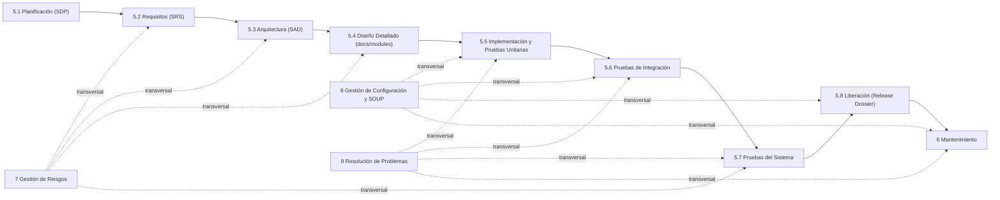

# Plan de Desarrollo de Software (SDP) — SISAP by CENIVRA v1.1

## Control Documental

| Campo | Valor |
|---|---|
| **Código documental** | `SISAP-LC-002` |
| **Título** | Plan de Desarrollo de Software (SDP) conforme a procesos IEC 62304 §5.1 |
| **Versión** | `1.1.0-draft` |
| **Estado** | **En revisión** |
| **Fecha de creación** | 2026-11-23 |
| **Última actualización** | 2026-11-23 |
| **Autor / Responsable** | Responsable de Ingeniería de Software — CENIVRA / SISAP |
| **Revisor y aprobación** | **Pendiente de revisión formal** |
| **Documentos relacionados** | `SISAP-LC-000` · `SISAP-LC-001` · `SISAP-LC-003` · `SISAP-LC-004` · `SISAP-LC-014` · `SISAP-LC-016` |

### Historial de Cambios

| Versión | Fecha | Descripción | Responsable |
|---|---|---|---|
| `1.1.0-draft` | 2026-11-23 | Sustitución operativa del SDP conceptual Python/Dash (ago 2026) por el SDP real del stack `v1.1.0` (Electron 45 / React 19 / TypeScript 7 / Node.js >=22.5 SQLite WAL / R >=4.0). | Equipo de Ingeniería SISAP |

---

## 1. Alcance y Objetivos del Desarrollo

Este plan rige el ciclo de vida de desarrollo, verificación, configuración, gestión de riesgos y liberación de **SISAP by CENIVRA** dentro del directorio operativo `sisap-by-cenivra-—-sistema-de-información-clínica-y-gobernanza/` y su sistema documental en `docs/`.

Cubre explícitamente:
- **Frontend SPA / Desktop:** React 19 + TypeScript + Vite 8 + Electron 45.
- **Backend Local Restringido (`127.0.0.1:8080`):** Node.js ESM (`>=22.5.0`) + módulo `node:sqlite` + migraciones `001`, `002`, `003`.
- **Motores de Inteligencia (`engines/autoencoder/` y `backend/src/services/`):** Motor 1 (Autoencoder TUS 22v/24v/17v), Motor 2 (Longitudinal RCI), Motor 3 (Narrativa léxica/ONNX), Motor 4 (Integración multimodal), Motor 5 (Apoyo a decisiones `E1–E5`).
- **Centro de Evaluación Psicométrica (`engines/psychometrics/` y `src/psychometrics/`):** Catálogo versionado de 6 escalas activas + motor de puntuación en 5 capas + persistencia inmutable en 3 niveles.
- **Scripts de reproducibilidad científica en R (`>=4.0`)** y utilidades CLI (`init-db.js`, `seed-fixtures.js`, `health.js`, `backup.js`).

---

## 2. Modelo de Ciclo de Vida y Procesos Aplicables

SISAP adopta un **modelo incremental e iterativo controlado por riesgos**, estructurado directamente sobre los procesos definidos en **IEC 62304:2006 + AMD1:2015**:

**Regla operativa obligatoria:** Ninguna evolución se considera completada por existir únicamente en código; requiere requisitos trazables en `SISAP-LC-003`, análisis de riesgo actualizado en `SISAP-LC-004`, diseño modular en `docs/modules/`, evidencia de pruebas en `SISAP-LC-008..010` y actualización de línea base en `SISAP-LC-014`.

---

## 3. Responsables y Funciones (Estructura de Roles)

| Rol Funcional | Responsabilidades IEC 62304 |
|---|---|
| **Líder de Producto / Dirección Clínica** | Aprueba uso previsto (`SISAP-LC-001`), alcance de instrumentos psicométricos, límites éticos (`E1–E5`, no diagnóstico automático) y autorización de releases. |
| **Responsable Clínico y Psicométrico** | Valida fidelidad de reactivos frente a cuadernillos/fuentes autorizadas, reglas de inversión, manejo de faltantes y pertinencia de alertas longitudinales. |
| **Responsable de Arquitectura e Ingeniería de Software** | Mantiene `SAD`, diseño detallado de API/BD/UI, estándares de codificación, seguridad loopback/WORM e inventario SOUP (`SISAP-LC-016`). |
| **Responsable de Modelado Científico (Autoencoder)** | Mantiene contratos del pipeline de 5 capas, verificación SHA-256 de pesos, métricas confirmatorias, reproducibilidad en R y prohibición de sobreafirmación. |
| **Responsable de Verificación y Calidad (V&V)** | Ejecuta y audita suites (`node --test`, `tsc --noEmit`, `vite build`, `Rscript`, `health.js`), trazabilidad bidireccional (`SISAP-LC-015`) y bitácora de problemas (`SISAP-LC-013`). *(Debe preservar independencia de criterio en revisión respecto a quien implementó el cambio).* |

*(En equipos compactos una persona puede asumir más de un rol técnico operativo, pero los documentos críticos deben permanecer en estado `En revisión` hasta que la verificación independiente se registre sin auto-aprobación ficticia).*

---

## 4. Criterios de Entrada y Salida por Fase

| Fase | Criterio de Entrada | Entregables Obligatorios | Criterio de Salida Verificable |
|---|---|---|---|
| **5.1 Planificación** | Alcance de versión y rama Git definida | `SISAP-LC-001`, `SISAP-LC-002` | Plan, roles y SOUP inicial definidos. |
| **5.2 Requisitos** | Necesidades clínicas, analíticas y regulatorias | `SISAP-LC-003` actualizado | Todos los `REQ-*` poseen ID, criterio verificable, riesgo y prueba asignada. |
| **5.3–5.4 Diseño** | Requisitos congelados para el incremento | `SISAP-LC-005`, `SISAP-LC-006`, `docs/modules/*` | Contratos REST, esquema SQLite e interfaces documentadas y sin contradicciones. |
| **5.5–5.6 Implementación e Integración** | Diseño revisado y migraciones aditivas preparadas | Código en `src/`, `backend/`, `engines/` + tests unitarios e integración | `tsc --noEmit` con 0 errores y 100% de `node --test` + tests unitarios R en `PASS`. |
| **5.7 Sistema y Seguridad** | Paquete compilable e integración estable | `SISAP-LC-009`, `SISAP-LC-010`, escaneo higiene PHI/rutas | `vite build` sin errores, `init-db` + `seed-fixtures` + `health` OK, 0 secretos/rutas locales en diff. |
| **5.8 Liberación** | Todos los criterios 5.1–5.7 satisfechos y riesgos mitigados | `SISAP-LC-011`, `SISAP-LC-014`, `SISAP-LC-015`, `CHANGELOG.md`, `RELEASE_NOTES` | Aprobación explícita de release registrada antes de crear tag público o artefacto `.exe`. |

---

## 5. Estrategia de Verificación, Riesgos, Configuración, SOUP y Releases

1. **Estrategia de Verificación y Pruebas:**
   - Pruebas automatizadas Node.js nativas (`npm test` -> `node --test backend/test/*.test.js`), verificación estática TypeScript (`npm run lint` -> `tsc --noEmit`), empaquetado frontend (`npm run build` -> `vite build`), ciclo limpio SQLite en directorio temporal aislado (`SISAP_DB_DIR`), y pruebas estadísticas/numéricas en R (`Rscript` sobre `engines/autoencoder/tests/`).
   - Distinción obligatoria entre pruebas ejecutadas automáticamente, pruebas manuales pendientes (usabilidad clínica en campo) y pruebas omitidas de forma controlada por ausencia de Excel clínico confidencial en el repositorio público.
2. **Gestión de Riesgos (`SISAP-LC-004`):** Evaluación continua conforme a IEC 62304 §7 e ISO 14971:2019; todo control implementado en código debe vincularse a un identificador `TEST-*` verificable.
3. **Gestión de Configuración y Preservación de Versiones (`SISAP-LC-014`):**
   - El release histórico **`v1.0.0`** (commit `ea500b34d9db37ee7c7c3e3f9f0b0345f2f2da1f` y rama `main`) permanece inmutable.
   - El desarrollo de `v1.1.0` transcurre exclusivamente en `release/1.1.0` mediante commits temáticos verificables (`4cb847b`, `bb7078e`, `b9e94d7`, `7bca47e`).
   - Los pesos de modelos y percentiles de referencia están protegidos mediante hashes SHA-256 en `model_registry.json`.
4. **Control de SOUP (`SISAP-LC-016`):** Todo paquete externo (`package-lock.json`), runtime (`Node.js`, `Electron`, `R`) o modelo de terceros se registra con versión exacta, licencia, finalidad, riesgos y estrategia de actualización.
5. **Gestión de Problemas (`SISAP-LC-013`):** Todo defecto detectado durante desarrollo, pruebas o uso se registra con severidad, evidencia de reproducción, causa raíz, corrección y prueba de regresión.
6. **Autorización de Releases (`SISAP-LC-011`):** Ningún tag nuevo ni instalador público puede publicarse si existen pruebas fallidas de regresión, secretos/datos identificables en el árbol Git, contradicciones documentales no declaradas o brechas de seguridad activas.
