# Inspección Técnica Integral de Solo Lectura: Autoencoder, Gobernanza de Modelos y Control de Acceso por Roles (SISAP-by-CENIVRA)

## Control Documental

| Campo | Valor |
|---|---|
| **Código documental** | `SISAP-ARCH-AE-GOV-001` |
| **Título** | Auditoría Técnica y Científica del Motor Autoencoder, Trazabilidad de Modelos y Gobernanza RBAC (Fase Previa de Solo Lectura) |
| **Versión** | `1.0.0` |
| **Estado** | **Emitido — Inspección de Solo Lectura (sin cambios en código, BD ni permisos)** |
| **Fecha de emisión** | 2026-11-23 |
| **Línea base auditada** | Rama `release/1.1.0` (commit HEAD `0af0621d23b46d2fbc138211919c33bb6d4ae3ac`, preservando intactos `main` en `ea500b34d9db37ee7c7c3e3f9f0b0345f2f2da1f` y tag `v1.0.0` en `defbfc4e42f9e7cc78fe334bffbf56d68e5a7945`) |
| **Directorios auditados** | 1. Repositorio principal `GITHUB_REPOS\SISAP-by-CENIVRA`<br>2. Carpeta científica `Estratificación Funcional Transversal en TUS\Analisis para la app` y fuentes vinculadas en `Analisis en R Fase Transversal` |
| **Marco normativo de referencia** | IEC 62304:2006+AMD1:2015 (§5.3, §5.5, §7.1, §8) · ISO 14971 · NOM-024-SSA3-2012 · LFPDPPP |

> [!IMPORTANT]
> **Declaración estricta de alcance (Solo Lectura):** Durante esta inspección no se modificó código fuente (`src/`, `backend/`, `engines/`), configuraciones, bases de datos SQLite, pesos neuronales, manifiestos ni reglas de roles/permisos. Asimismo, se distingue rigurosamente entre **integridad criptográfica** (hash SHA-256), **ejecución técnica sin errores**, **reproducción matemática interna sobre la cohorte de desarrollo ($N=166$)** y **validación clínica prospectiva externa**.

---

## 1. Inventario Completo de Modelos, Versiones y Artefactos del Autoencoder

Entre la carpeta de análisis científico (`Estratificación Funcional Transversal en TUS`) y el repositorio principal (`SISAP-by-CENIVRA`, aplicación en `sisap-by-cenivra-—-sistema-de-información-clínica-y-gobernanza/` y archivos heredados en raíz `/data`, `/app`, `/_HISTORICO`) coexisten **cuatro generaciones/familias de Autoencoder** más un conjunto de **artefactos auxiliares, heredados o inválidos**.

### 1.1. Tabla Maestra de Inventario (12 Atributos por Artefacto)

| Nombre / ID | Ruta exacta (abreviada sobre raíz verificada) | Tipo | Tamaño (bytes) | Fecha mod. | Hash SHA-256 | Arquitectura | Variables de entrada | Dim. latente | Dependencias | Estado de verificación | Observaciones |
|---|---|---|---:|---|---|---|---|---:|---|---|---|
| **`encoder_22_checkpoint_fase2` (Encoder H5)** | `Analisis en R Fase Transversal\Datos Canonicos\04_MODELO_22\RUN_CANONICO_6d7b20a7\mfr_mejor_encoder_20260628_214641.h5` | Binario Keras/HDF5 (`float32`) | `26,400` | 2026-06-28 21:46:42 | `fc82dd7f7fbc87f3b45fd4455b2a8011cca5451c6f1eb64b82ddda005c77151f` | `22→32→24→12` (`selu`, `selu`, `linear`; `Dropout 0.15`, sin BN) | 22 (`ORDEN_CANONICO_22`: 24 sin `#10 STAXI_2STAXI_temperamento` y `#11 compuesto_staxi`) | 12 | R/Keras-TF 2.13.1 o extractor JSON | **Verificado matemático exacto** (interno $N=166$) | Único binario H5 que reproduce `representaciones_completas.csv` ($166\times 12$) con error máx `1.79e-7` (`r = 1.000000`). También existe copia de corrida gemela `213240` (`d6feff89...`). |
| **`encoder_22_checkpoint_fase2` (AE Completo H5)** | `Analisis en R Fase Transversal\Datos Canonicos\04_MODELO_22\RUN_CANONICO_6d7b20a7\mfr_mejor_modelo_20260628_214641.h5` | Binario Keras/HDF5 (Encoder + Decoder) | `101,480` | 2026-06-28 21:46:42 | `57d5aab9da932c5625da361a8710415abbae0870b135011856e5a5815a69a528` | `22→32→24→12→24→32→22` (`selu`/`linear`) | 22 | 12 | Keras 2.13.1 / TensorFlow | **Verificado técnico y matemático** (interno $N=166$) | Modelo completo del que se extrajeron los pesos del encoder + decoder. $R^2_{\text{ensemble}}=0.8336$, top-5 mean $R^2=0.8355$, $\text{MSE}_z=0.1645$. |
| **`pesos_autoencoder_22_completo.json`** | `sisap-by-cenivra-...\engines\autoencoder\models\pesos_autoencoder_22_completo.json` | JSON serializado (Encoder + Decoder) | `107,562` | 2026-11-23 12:03:12 | `313dcd2d8f7c136222eaff1c56583b02af332c259ff0aee85b02f349b93c3d9e` | `22→32→24→12→24→32→22` (`selu`, `selu`, `linear`, `selu`, `selu`, `linear`) | 22 | 12 | Node.js ESM (`>=22.5`) / TypeScript | **Verificado ejecución + paridad exacta R↔JS** | **Artefacto activo por defecto en SISAP v1.1.0.** Paridad `0.0000e+0` frente a R `4.6.1`; reproducción `1.151e-7` en `test_regresion_original.R`. |
| **`pesos_encoder_22_h5.json`** | `Analisis para la app\artefactos\modelo\pesos_encoder_22_h5.json` y `engines\autoencoder\models\pesos_encoder_22_h5.json` | JSON serializado (solo Encoder) | `52,253` | 2026-10-24 21:57:56 | `ee507679c44dd439dd4e85e47749f52548076a0d7b0c241f252712c2d009e3f3` | `22→32→24→12` (`selu`, `selu`, `linear`) | 22 | 12 | R (`R/06_inferencia_latente.R`) | **Verificado exacto** | Mismo encoder 22v sin capas de reconstrucción (decoder). |
| **`encoder_24_deployed` (Encoder H5 Shiny)** | `Analisis en R Fase Transversal\shiny_app\data\encoder.h5` (idéntico en `05_MODELO_24_DEPLOYED/`, repo `data/modelo/encoder.h5` y `_HISTORICO/_LOCAL_NO_VERSIONADO/`) | Binario Keras/HDF5 | `26,656` | 2026-06-29 15:15:51 | `598313c683529d60f9e957ea521b97cb66f6cf391a7edaee106f0b65dc129cfe` | `24→32→24→12` (`selu`, `selu`, `linear`; `Dropout 0.15`) | 24 (`ORDEN_CANONICO_24`, incluyendo los 2 ítems STAXI eliminados por correlación) | 12 | Keras 2.13.1 / TensorFlow | **Integridad verificada; procedencia no reproducible** | Re-entrenado al final de `Autoencoder TUS estratificacion.R` (L19049–19135) **sin `set.seed()` previo**. Sus salidas latentes **no coinciden** con `representaciones_completas.csv`. |
| **`encoder_24_deployed` (AE Completo H5 Shiny)** | `Analisis en R Fase Transversal\shiny_app\data\autoencoder_completo.h5` y `05_MODELO_24_DEPLOYED\autoencoder_completo.h5` | Binario Keras/HDF5 | `103,016` | 2026-06-29 15:15:57 | `03e7423d3b48a683b7eb6483dda785c315dca8a7c3a94bb055e6f0c7632f2d9a` | `24→32→24→12→24→32→24` | 24 | 12 | Keras 2.13.1 / TensorFlow | **Pendiente de validación externa** | Contraparte completa de `encoder.h5` de `shiny_app`. |
| **`pesos_autoencoder_24_completo.json`** | `sisap-by-cenivra-...\engines\autoencoder\models\pesos_autoencoder_24_completo.json` | JSON serializado (Encoder + Decoder) | `111,325` | 2026-11-23 12:03:12 | `46d44a7ad05eabadc1caf70488bf2f9d6e513cb7486bdeed9d3e4bf3808694c6` | `24→32→24→12→24→32→24` | 24 | 12 | Node.js ESM / TypeScript | **Ejecutable técnico; sin validación externa ni percentiles propios** | Expuesto actualmente en el `<select>` de `IntelligenceEcosystemView.tsx`. Error grave: compara sus latentes contra percentiles derivados del modelo 22v. |
| **`pesos_encoder_24_h5.json`** | `Analisis para la app\artefactos\modelo\pesos_encoder_24_h5.json` y `engines\autoencoder\models\pesos_encoder_24_h5.json` | JSON serializado (solo Encoder) | `54,069` | 2026-10-24 21:57:58 | `184d4b88c6b5b00a8cbbdb74c6a28d9be2e81d227ead2f037c4d1b5dd6dc112c` | `24→32→24→12` | 24 | 12 | R (`R/06_inferencia_latente.R`) | **Ejecutable técnico; sin validación externa** | Extracción solo-encoder de `shiny_app/data/encoder.h5`. |
| **`ae_tus_17to12_m3k12` (`A_sem4_fold1.keras`)** | `ENTRENAMIENTO_AUTOENCODER_2026-11-14\11_EVALUACION_FINAL_Y_PREPARACION_SISAP\06_MODELO_CANDIDATO\A_sem4_fold1.keras` | Binario Keras v3 | `53,320` | 2026-11-14 19:19:21 | `05abc716d374a6de4f7d9cd943133d01d373dc6351ff3a1bcaf439bf50494fe3` | `17→24→12→24→17` (`selu`, `linear`, `selu`, `linear`) | 17 subescalas limpias (`ORDEN_CANDIDATO_17`, excluye `edad`, tiempos y compuestos) | 12 | TF 2.21.0 / Keras 3.15.1 | **Prototipo confirmatorio experimental** | Entrenado en 1 fold ($80\%$, $n=132$). Peor reconstrucción que PCA-12 ($\text{MSE}_{\text{orig}}=10.76$ vs $9.07$); congruencia de ejes $|r|=0.141$, geometría $r_{\text{dist}}=0.857$. +45 folds en `01_EVALUACION_CONFIRMATORIA\modelos\`. |
| **`pesos_candidato_17_m3k12.json`** | `sisap-by-cenivra-...\engines\autoencoder\models\pesos_candidato_17_m3k12.json` | JSON serializado (`17→24→12→24→17`) | `44,603` | 2026-11-23 12:03:12 | `28b3a56666c1feb6712e9f4c3bdd1fa16f010bc80b76b6dddc540fdeffd31a44` | `17→24→12→24→17` | 17 | 12 | Node.js ESM (`backend/src/routes/index.js` `/candidate17/infer`) | **Aislado para comparación académica** | Bloqueado para flujo clínico autónomo; endpoint separado (`candidate17/infer`). |
| **`checkpoint_fase2.rds` + `representaciones_completas.csv`** | `Datos Canonicos\04_MODELO_22\CHECKPOINT\checkpoint_fase2.rds` y `shiny_app\data\representaciones_completas.csv` | RDS / CSV referencia (`166×12`) | `20,157` / `37,864` | 2026-06-29 | `c5f6ad8b...` / `c6459cb3ba438e3f0bf88dccf74690b2835518c30a013127a7e39064996907b2` | N/A (salidas de `encoder_22_checkpoint_fase2`) | N/A | 12 | R (`checkpoint_fase2`) / Latent analyzer | **Referencia interna verificada** | Matriz de 166 pacientes producida por `22→32→24→12` pero copiada junto a `encoder.h5` (24v) en `shiny_app/data/`. |
| **`parametros_referencia_completos.json` y `percentiles_referencia_12d.json`** | `sisap-by-cenivra-...\engines\autoencoder\preprocessing\` y `models\` | Preprocesamiento `[q01, q99], μ, σ` y cuantiles `12D` ($N=166$) | `18,290` / `4,772` | 2026-10-24 / 2026-11-23 | `bb067e40...` / `7dbbe884...` | N/A | 24 / 12 | 12 | Node.js / TS (`autoencoderData.ts`) | **Verificado (`1.554e-14`)** | `percentiles_referencia_12d.json` corresponde únicamente a las 12 dimensiones del modelo **22v**. |
| **Familia Histórica Exploratoria (`AE8MT_21VARS`, `AE_DIM10_10VARS`, `AUTOENCODER_V2`, `LEGACY`, grids `FASE1/2`)** | `Datos Canonicos\99_HISTORICO_NO_CANONICO\*`, `resultados_ae8mt\*`, `resultados_experimentos\*` (~140 archivos `.h5`) | Binarios Keras/HDF5 históricos | `7,816` – `101,480` | Ene–Jun 2026 | Ej. `b6476bec...` (`20260212`), `462d3a3a...` (`20260330`), `9735e806...` (`20260628`) | `16-12-8`, dim `8`/`10`, y grids `22→32→24→12` | 10, 21 o 22 | 8, 10 o 12 | Keras legado | **Histórico / No canónico** | Los binarios `resultados_ae8mt` de feb–mar tienen bottleneck `8` o `10` ($R^2_{\text{max}}=0.6517$), no coinciden con la arquitectura `12` descrita en la publicación ICAIMH 2026. |
| **`ENCODER_PROJECTION_WEIGHTS` (en código TS)** | `sisap-by-cenivra-...\src\data\autoencoderData.ts` (L150–167) | Matriz calculada `24×12` en TS | En bundle JS | 2026-11-23 | N/A (expresión en tiempo de carga) | Producto lineal `w1 * w2 * wb` de `VERIFIED_AUTOENCODER_24` (sin sesgos ni `SELU`) | 24 | 12 | Navegador React/TS | **Inválido / Legacy visual en UI** | En **`v1.0.0`** contenía las **primeras 24 filas de pacientes (`ID=1..24`)** de `representaciones_completas.csv`. En **`v1.1.0`** fue reemplazada por el producto matricial lineal de la versión 24v, pero `AnalysisModelView.tsx` aún la exhibe y etiqueta como `LeakyReLU(0.1)`. **No ejecuta inferencia real.** |
| **`data/modelo/parametros_normalizacion.csv` y `gmm_model_2.json`** | `GITHUB_REPOS\SISAP-by-CENIVRA\data\modelo\*` | CSV / JSON legado Dash/Shiny | `2,542` / `1,968` | Históricos | `d64c60b6...` / `b739f083...` | GMM (`G=2`) y tabla degenerada 43 vars (`μ≈0, σ=1`) | 43 (sin `edad`) / 12 | N/A | Ninguno (inactivo) | **Inválido / Excluido (`D-03`)** | Excluidos expresamente del runtime activo de `v1.1.0`. |
| **`modelo.onnx` (`bsc-bio-ehr-es`)** | `GITHUB_REPOS\SISAP-by-CENIVRA\data\modelo\nlp\bsc-bio-ehr-es\modelo.onnx` | Grafo ONNX incompleto (NLP clínico) | `1,378,358` | 2026-09-30 | `8990bfee89a353114f69e327178ead2a8c98dd7ef72bce3b67005f5564661d2a` | RoBERTa-base (12 capas declaradas en `manifest.json`) | Texto libre (512 tokens) | 768 → 12 prov. | `onnxruntime-node` (ausente) | **Inválido / No ejecutable** | Con `1.38 MB` carece de pesos densos (>400 MB requeridos) y `onnxruntime` no está instalado; auditado como inactivo por `narrativeService.js`. |

---

## 2. Matriz de Evidencia Científica y Estado de Validación

Se separan explícitamente los cuatro criterios de evidencia para evitar atribuir validez clínica a artefactos que únicamente pasaron pruebas de software o integridad de archivo:

| Generación / Artefacto | 1. Integridad criptográfica (SHA-256) | 2. Ejecución técnica sin errores | 3. Reproducción matemática exacta (cohorte interna) | 4. Validación científica / clínica externa | Clasificación final autorizada |
|---|---|---|---|---|---|
| **Generación A: Publicación ICAIMH 2026 y rama `21 vars` ($N=155$)** | Parcial (archivos `.h5` históricos intactos en `99_HISTORICO_NO_CANONICO`) | Solo en Keras legado; no integrado en SISAP | **NO**: contradicción documental interna (mezcla $N=155 \times 21$ con métricas $N=166 \times 22$; `.h5` reales tenían cuello `8`/`10`) | **NO** (un solo centro transversal $N=155$, sin cohorte externa) | **Histórico / No utilizable** |
| **Generación B: `encoder_22_checkpoint_fase2` (`22→32→24→12→24→32→22`)** | **SÍ** (`fc82dd7f...` / `57d5aab9...` / `313dcd2d...` verificados en `model_registry.json`) | **SÍ** (5 suites R PASS + tests backend/frontend Vitest + paridad R↔JS `0.0000e+0`) | **SÍ** (`max_abs_diff = 1.79e-7` en JSON / `1.151e-7` en R respecto a `representaciones_completas.csv` $166\times 12$; $r = 1.000000$; $R^2=0.8336$) | **NO** (entrenado y evaluado sobre $N=166$ transversal unicéntrico; sin validación longitudinal ni cohorte prospectiva externa; dimensiones opacas `MOD-03`) | **Activo por defecto recomendado para hipótesis exploratoria (`E4_latent_hypothesis`)** |
| **Generación C: `encoder_24_deployed` (`shiny_app/data/encoder.h5`)** | **SÍ** (`598313c6...` / `46d44a7a...` verificados) | **SÍ** (paridad R↔Node `0.0000e+0`) | **NO respecto a `representaciones_completas.csv`** (reentrenado al final de script sin `set.seed()`; sus latentes difieren de los percentiles `12D` guardados) | **NO** | **Experimental / Restringido — Retirar de vista clínica** |
| **Generación D: `ae_tus_17to12_m3k12` (`A_sem4_fold1.keras`, `17→24→12`)** | **SÍ** (`05abc716...` / `28b3a566...`) | **SÍ** (`POST /api/engines/autoencoder/candidate17/infer`, `MSE_orig = 1.2228` en smoke test) | Validado estadísticamente por CV 5-fold × 3 semillas ($R^2_{\text{orig}}=0.847$, $r_{\text{dist}}=0.857$, pero inferior a PCA-12 $\text{MSE}=9.07$ y congruencia de ejes $0.141$) | **NO** (`LIMITACIONES_CANDIDATO_17V.md` prohíbe uso clínico; entrenado en 80% de 1 fold $n=132$) | **Prototipo confirmatorio experimental — Solo investigación** |
| **`ENCODER_PROJECTION_WEIGHTS` (`24×12` en `AnalysisModelView`)** | No aplica (código TS) | Solo renderizado tabular | **NO** (en `v1.0.0` eran filas de 24 pacientes; en `v1.1.0` es producto lineal sin `SELU` ni sesgos de `24v`) | **NO** | **Artefacto UI heredado engañoso — Debe eliminarse o aislarse** |
| **GMM Clustering (`gmm_model_2.json`, `G=2/3/4`)** | `b739f083...` | Inactivo en código | Inestable entre cortes (Jaccard `0.269`, contradicción `G=2` vs `3` vs `4`) | **NO** | **Excluido de SISAP (`D-03`)** |
| **NLP Clínico (`modelo.onnx` 1.38 MB)** | `8990bfee...` | **NO** (`onnxruntime` ausente, pesos densos ausentes) | N/A | **NO** | **Inválido / No operativo** |

---

## 3. Identificación Exacta de lo que SISAP Ejecuta Hoy

### 3.1. En el Backend (`node:http` + `node:sqlite`)

1. **`POST /api/engines/autoencoder/infer`** (`backend/src/routes/index.js:170` → `backend/src/services/autoencoderService.js:51`):
   - Acepta `payload.model_id` directamente del cliente HTTP. Si se omite, asigna `'encoder_22_checkpoint_fase2'`.
   - Permite `'encoder_22_checkpoint_fase2'` **y** `'encoder_24_deployed'` (`autoencoderService.js:62`).
   - Ejecuta `runFullPipelineSisap()` (`engines/autoencoder/inference/autoencoderInferenceEngine.js`): compuerta estricta `D-06`, cálculo de 6 escalas, vector de 24 columnas, winsorización `[q01, q99]` + Z-score, pase forward de 5 capas (`selu`/`selu`/`linear`/`selu`/`selu`/`linear`), percentiles `12D` y error de reconstrucción `MSE_z`.
   - **Persistencia condicional (`persist === true`):** solo inserta en `model_runs` y `model_outputs` si el cliente envía explícitamente `persist: true` y un `patient_id` UUID válido de SQLite (`autoencoderService.js:71, 90`). Si `persist` es `false` o se omite, la inferencia no deja registro alguno en base de datos.

2. **`POST /api/engines/autoencoder/candidate17/infer`** (`routes/index.js:176`):
   - Ejecuta `ae_tus_17to12_m3k12` (`pesos_candidato_17_m3k12.json`), aislado de `model_runs` y etiquetado como comparación experimental.

### 3.2. En el Frontend (`React 19 + TypeScript`)

| Pantalla (`NavScreen`) | Qué ejecuta realmente hoy al usarla | Motor / modelo utilizado | ¿Cambia la inferencia si el usuario cambia algo? | ¿Persiste en SQLite (`model_runs`)? | Brecha detectada |
|---|---|---|---|---|---|
| **Ecosistema de Inteligencia** (`ecosistema` · `IntelligenceEcosystemView.tsx`) | Lee el último registro en `localStorage` (`StorageService.getEvaluations(selectedPseudonym)`, L137), valida `D-06` y ejecuta inferencia **en el navegador** (`AutoencoderEngine.runVerifiedInference(v24, selectedModelId)`, L200). | Por defecto `encoder_22_checkpoint_fase2`, **conmutable por el clínico** a `encoder_24_deployed` en `<select>` (L548–560). | **SÍ:** al cambiar el `<select>`, recalcula `latentDimensions`, `MSE_z` y `L2_norm` con `VERIFIED_AUTOENCODER_24` (`24→32→24→12→24→32→24`). | **NO:** solo vive en memoria React (`useMemo`). | (1) Un clínico puede cambiar la versión de red neuronal en vivo; (2) `encoder_24_deployed` se compara contra percentiles `12D` del modelo **22v** (`PERCENTILES_REFERENCIA_12D`); (3) no lee evaluaciones nuevas capturadas en `PsychometricCenterView`. |
| **Evaluación Inicial (Resumen)** (`eval_inicial` · `InitialEvaluationView.tsx`) | Al pulsar *Ejecutar Inferencia* o *Guardar Evaluación Final*, ejecuta `AutoencoderEngine.runVerifiedInference(vector24, 'encoder_22_checkpoint_fase2')` en el navegador (L197, L237), guarda en `localStorage` (`StorageService.saveEvaluation`, L284) y llama a `POST /api/engines/autoencoder/infer` con **`persist: false`** (L306–308). | `encoder_22_checkpoint_fase2` (fijo en duro). | No hay selector de versión del modelo (sí selector de `modo_scoring`: `excel_canonico` vs `manual_estandar`). | **NO:** envía `persist: false` y ni siquiera incluye `patient_id` UUID, por lo que `model_runs` permanece vacío aunque el backend esté arriba. Si falla el backend hace `catch` silencioso (L326). | Desincronización entre `localStorage` y `model_runs`/`model_outputs` en SQLite. |
| **Centro Psicométrico** (`centro_psicometrico` · `PsychometricCenterView.tsx`) | Aplica los 6 instrumentos digitales y calcula subescalas reales (`scorePsychometricEvaluation`), guardando en `localStorage` y en SQLite (`psychometric_evaluations`, `psychometric_item_responses`, `psychometric_results`, L290). | Motor psicométrico de reglas (sin llamada al Autoencoder). | N/A | **NO dispara Motor 1:** completar las 6 escalas basales en `PsychometricCenterView` **no** genera automáticamente una corrida en `model_runs` ni alimenta `IntelligenceEcosystemView`. | Desconexión funcional entre la nueva captura digital estrella y Motor 1. |
| **Simulador Autoencoder** (`simulador` · `AutoencoderSimulatorView.tsx`) | Toma 4 arquetipos sintéticos codificados en duro (`Arquetipo A..D`, L62–199) y ejecuta `AutoencoderEngine.runTransversalInference(rawVector24)` (L243), que delega en `encoder_22_checkpoint_fase2`. | `encoder_22_checkpoint_fase2` sobre vectores sintéticos fijos. | Solo cambia entre los 4 arquetipos predefinidos. | **NO.** | Visible para todos los roles; incluye pestaña "Solicitud de Artefactos" con texto heredado que sugiere que los pesos `.h5` no existen en el software cuando ya están integrados en JSON. |
| **Arquitectura y Pesos** (`analisis` · `AnalysisModelView.tsx`) | Llama a `AutoencoderEngine.getActiveWeights()` (L55), que retorna `ENCODER_PROJECTION_WEIGHTS` (`w1*w2*wb` de 24v sin sesgos ni `SELU`), los muestra como tabla `24×12` con texto `LeakyReLU(α=0.1)` (L345), ofrece modal *"Importar / Ajustar Pesos"* (bloqueado por `setCustomWeights` -> `false`, L127) y en la pestaña *Sandbox* ejecuta `runTransversalInference` (`22v`) usando **44 ítems** para `STAXI-2` (L67, L85) en vez de 49. | Contradictorio: muestra matriz lineal `24×12` de `24v`, código PyTorch de 1 capa, y en Sandbox corre `22v` con 44 ítems STAXI-2. | El sandbox recalcula en vivo con 44 ítems STAXI-2. | **NO.** | Induce a error técnico al mostrar una matriz lineal `24×12` como si fueran los pesos reales del modelo de 5 capas SELU, y usa un contrato obsoleto de 44 ítems para STAXI-2. |
| **Narración Semanal V1.0** (`narracion` · `WeeklyNarrativeView.tsx`) | Captura respuestas `q1..q8`. Su botón *"Ejecutar Motor A (DCSA ae_multihead)"* llama a `ejecutarInferenciaNarracion()` (L133–189), que tras `800 ms` devuelve siempre `estado: 'failed'` (`MODELO_NO_DISPONIBLE`). | Stub deliberado desactivado. | No aplica. | Registra intento en `StorageService.logAction`. | Correctamente bloqueado contra resultados ficticios, pero coexiste sin unificación explícita con el análisis léxico de Motor 3 en `IntelligenceEcosystemView`. |

---

## 4. Diagrama del Flujo Real de Inferencia (Estado Actual vs Brechas)

```mermaid
flowchart TD
  U["Usuario autenticado en UI React\n(Sin filtro por rol en Sidebar salvo capa_blindada)"] --> P1["Centro Psicométrico\n(PsychometricCenterView.tsx)"]
  U --> P2["Evaluación Inicial\n(InitialEvaluationView.tsx)"]
  U --> P3["Ecosistema de Inteligencia\n(IntelligenceEcosystemView.tsx)"]
  U --> P4["Simulador Autoencoder y\nArquitectura/Pesos"]

  P1 -->|"Guarda 3 niveles en\nlocalStorage + SQLite\n(psychometric_*)"| G1["BRECHA: No dispara Motor 1\nal completar 6 escalas"]
  P2 -->|"1. Corre inferencia local JS\n(encoder_22_checkpoint_fase2)"| LS["localStorage\n(initial_evaluations)"]
  P2 -->|"2. POST /api/engines/autoencoder/infer\ncon persist:false (catch silencioso)"| API_NO_PERSIST["Backend ejecuta inferencia\nSIN guardar en model_runs"]

  P3 -->|"Lee SOLO localStorage\n(initial_evaluations)"| LS
  P3 -->|"Selector <select> expuesto a\nTODOS los roles clínicos"| SEL{"selectedModelId\n(React useState)"}
  SEL -->|"Default: encoder_22_checkpoint_fase2"| AE22["TS: runVerifiedInference\npesos_autoencoder_22_completo.json\n(22->32->24->12->24->32->22)"]
  SEL -->|"Switch clínico: encoder_24_deployed"| AE24["TS: runVerifiedInference\npesos_autoencoder_24_completo.json\n(24->32->24->12->24->32->24)"]
  AE22 --> PCT["Compara contra percentiles_referencia_12d.json\n(Derivados de N=166 con modelo 22v)"]
  AE24 -->|"DESAJUSTE CIENTÍFICO:\nPercentiles 22v aplicados a salida 24v"| PCT

  P4 -->|"AnalysisModelView.tsx"| MAT["Muestra ENCODER_PROJECTION_WEIGHTS\n(Producto lineal w1*w2*wb 24v)\n+ Sandbox STAXI-2 con 44 ítems"]

  EXT["Cliente HTTP local (127.0.0.1:8080)"] -->|"Sin auth ni verificación RBAC"| RT["backend/src/routes/index.js"]
  RT -->|"Acepta body.model_id libremente"| SRV["autoencoderService.js\nSolo persiste en model_runs si persist:true"]
  SRV -->|"Falta artifact_sha256 y input_schema_version"| DB[("SQLite:\nmodel_runs / model_outputs")]
```



---

## 5. Matriz de Todos los Motores de Inteligencia de SISAP

| Motor / Módulo | Función prevista | Archivos reales (`src/` y `backend/`) | Tipo real de implementación | Artefacto o parámetros que consume | Entradas | Salidas | Limitaciones actuales |
|---|---|---|---|---|---|---|---|
| **Motor 1: Autoencoder Transversal** | Representación latente continua 12D y error de reconstrucción por variable | `src/services/autoencoderEngine.ts`, `engines/autoencoder/inference/autoencoderInferenceEngine.js`, `backend/src/services/autoencoderService.js`, `IntelligenceEcosystemView.tsx`, `InitialEvaluationView.tsx` | **Inferencia neuronal real** (MLP Autoencoder 5 capas `SELU` + `Linear`) | `pesos_autoencoder_22_completo.json` (`107 KB`), `pesos_autoencoder_24_completo.json` (`111 KB`), `parametros_referencia_completos.json`, `percentiles_referencia_12d.json`, `pesos_candidato_17_m3k12.json` | 6 escalas basales (144+ ítems) + `edad`, `tiempo_consumo`, `trat_previos` | Vector `latent_01..12`, cuantiles `N=166`, `MSE_z`, `RMSE_z`, `L2_norm`, residuos por variable | Selección de versión abierta al clínico en UI; `model_runs` sin escritura desde frontend (`persist:false`); sin validación prospectiva externa. |
| **Motor 2: Analítica Longitudinal** | Trayectorias intraindividuales, tasas de cambio y cambio confiable (RCI) | `backend/src/services/analyticalService.js`, `IntelligenceEcosystemView.tsx` (L205–260) | **Fórmula estadística determinista** (`Jacobson-Truax RCI = (X2 - X1) / (SD * sqrt(2*(1-r_xx)))`, umbral `±1.96`) | Constantes fijas `NORMATIVE_RCI_PARAMS` para 4 escalas (`GAD-7`, `BSL-23`, `EROS`, `BADS`) | `initial_evaluations`/`scale_scores` + `follow_up_evaluations` | Deltas, `rci`, dirección (`reliable_improvement`/`deterioration`) y alertas | Solo 4 de 10 instrumentos tienen parámetros RCI; si hay `<2` puntos reporta `E5`; en frontend usa `localStorage` separado del backend. |
| **Motor 3: Inteligencia Narrativa y Conductual** | Extracción de procesos conductuales y afectivos en texto clínico | `backend/src/services/narrativeService.js`, `IntelligenceEcosystemView.tsx` (L49–74, L263–326) | **Regla léxica determinista** (normalización Unicode NFD + búsqueda de subcadenas en 4 categorías + métricas `TTR`/tokens) | Diccionario estático `PROCESS_MARKERS` (backend) / `PROCESS_LEXICON` (frontend). Audita `modelo.onnx` como **no disponible** (`1.38 MB < 20 MB`) | Respuestas `q1..q8` (`weekly_observations`) y notas de evolución | Conteo de palabras, diversidad léxica (`TTR`), coincidencias `craving_impulso`, `evitacion_experiencial`, `disregulacion_afectiva`, `activacion_afrontamiento` (`pending_human_review`) | No usa NLP neuronal ni contexto semántico/negación ("no tengo craving" activa el marcador `"craving"`). |
| **Motor 4: Integración Multimodal** | Unificar fuentes preservando procedencia, temporalidad y completitud sin imputación silenciosa | `backend/src/services/multimodalService.js`, `IntelligenceEcosystemView.tsx` (L328–370) | **Regla determinista de agregación y trazabilidad** | Tablas SQLite (`patients`, `clinical_records`, `initial_evaluations`, `model_runs`, `follow_up_evaluations`, `weekly_observations`) | Identificador `patient_id` | Matriz `modality_provenance_matrix` con 5 fuentes y `integration_readiness_ratio` | En el backend lee SQLite; en el frontend (`IntelligenceEcosystemView`) ensambla localmente desde `localStorage`, causando posibles divergencias. |
| **Motor 5: Apoyo a Decisiones Clínicas (CDSS)** | Síntesis trazable de hallazgos `E1–E5`, comparador geométrico `12D` y registro de formulaciones | `backend/src/services/decisionSupportService.js`, `IntelligenceEcosystemView.tsx` (L372–480, L818–960) | **Regla determinista + álgebra geométrica** (distancia Euclidiana $L_2$ y similitud coseno en 12D; listado de alertas RCI y residuos AE) | Salidas de Motores 1..4 y `percentiles_referencia_12d.json` | Perfil multimodal + selección de objetivo de comparación (`p50` u otro expediente) + texto de formulación clínica | Distancia $L_2$, similitud coseno, reporte Markdown, registro `clinical_formulations` con `review_status = pending_human_review` | En frontend las formulaciones locales viven en `useState` efímero (se pierden al cambiar de vista si el backend no sincroniza); en comparador UI no valida compatibilidad entre `22v` y `24v` entre pacientes. |
| **Módulo Legacy `Motor A — DCSA ae_multihead`** | Inferencia profunda sobre narrativas semanales | `src/components/views/WeeklyNarrativeView.tsx` (L130–198), `backend/src/services/modelRunService.js` | **Stub bloqueado deliberadamente** | Ninguno (pesos DCSA no distribuidos) | Texto `q1..q8` | Estado fijo `'failed'` (`MODELO_NO_DISPONIBLE`) tras `800 ms` | No existe modelo entrenado serializado; se mantiene únicamente como frontera de error explícito. |
| **Módulo Centro Psicométrico (3 Niveles)** | Aplicación digital por reactivos y calificación estandarizada sin secuencia numérica manual | `src/psychometrics/*`, `backend/src/psychometrics/*`, `backend/src/services/psychometricService.js` | **Motor psicométrico de reglas deterministas** | `engines/psychometrics/catalog_v1.json` (`BIS-11`, `BSL-23`, `GAD-7`, `EROS`, `BADS`, `STAXI-2`; `OCI-R` excluido) | Respuestas por ítem + complementos (`BSL_general_0_1`, conductual) | Totales, subescalas, recodificados, faltantes y espejo a `follow_up_evaluations` | No dispara Motor 1 automáticamente al cerrar el 6.º instrumento basal. |

---

## 6. Mapa Completo de Roles, Vistas, Rutas y Permisos

### 6.1. Matriz de los 10 Roles en `src/constants/clinicalConstants.ts` (L15–136)

| `RoleKey` | Nombre visible | `ve_identidad` | `reidentifica` | `escribe` | `usa_modelo` | `administra` | `capa_blindada` | `exportar_drive` | Propósito declarado |
|---|---|:---:|:---:|:---:|:---:|:---:|:---:|:---:|---|
| `superadmin` | Superadministración | Sí | Sí | Sí | Sí | Sí | **Sí** | Sí | Control integral, capa blindada y modelos |
| `admin` | Administración del Centro | No | No | No | **No** | **Sí** | No | Sí | Gestión de cuentas e infraestructura (sin PHI clínico) |
| `director_clinico` | Dirección Clínica | Sí | Sí | Sí | Sí | No | No | Sí | Supervisión clínica y aprobación diagnóstica |
| `psicologo` | Psicología Clínica | Sí | Sí | Sí | **Sí** | No | No | Sí | Rol inicial por defecto (`App.tsx:38`). Captura y análisis |
| `medicina` | Medicina / Psiquiatría | Sí | Sí | Sí | No | No | No | Sí | Evaluación médica y psicofarmacología |
| `enfermeria` | Enfermería | Sí | No | Sí | No | No | No | No | Signos vitales, fármacos, tamizaje |
| `consejero` | Consejería en Adicciones | No | No | Sí | No | No | No | No | Acompañamiento e incidentes (ciego) |
| `trabajador_social` | Trabajo Social | Sí | No | Sí | No | No | No | Sí | Entrevistas familiares y estudio socioeconómico |
| `coordinacion` | Coordinación Operativa | No | No | No | No | No | No | Sí | Estancias y estadísticas ciegas |
| `viewer` | Auditoría Externa / Solo Lectura | No | No | No | No | No | No | No | Inspección CECAJ / COFEPRIS |

### 6.2. Auditoría de Visibilidad y Control Real en Frontend (`Sidebar.tsx` y `App.tsx`)

El componente `Sidebar.tsx` (L44–52) define las propiedades opcionales `requiresAdmin?: boolean` y `requiresBlindLayer?: boolean`, **pero en el filtro real de navegación (L212–217) únicamente evalúa `requiresBlindLayer`**:

```ts
// Sidebar.tsx L212-217 (código actual verificado):
const visibleItems = group.items.filter((item) => {
  if (item.requiresBlindLayer && !roleConfig.capa_blindada) {
    return false;
  }
  return true;
});
```

Consecuencias verificadas en las **18 pantallas** de `NavScreen`:

| Grupo / Pantalla (`NavScreen`) | ¿Oculto en `Sidebar.tsx` según rol? | Guardarraíl interno en la vista (`src/components/views/*`) | Hallazgo crítico de acceso |
|---|---|---|---|
| `inicio` (`WorkDashboardView`) | No (todos) | Parcial (datos enmascarados según `ve_identidad`) | Esperado. |
| `pacientes` (`PatientsView`) | No (todos) | Oculta identidad si `!ve_identidad`; escritura condicional a `escribe` | Esperado. |
| `centro_psicometrico`, `entrevista`, `eval_inicial`, `seguimiento`, `evolucion`, `familiar`, `narracion` | No (todos, incluso `viewer`, `admin`, `coordinacion`) | Verifican `roleConfig.escribe` al intentar guardar | Roles sin permiso de escritura (`admin`, `viewer`) ven los formularios completos aunque no puedan guardar. |
| **`ecosistema` (`IntelligenceEcosystemView`)** | **No (todos los 10 roles)** | **Ninguno sobre `usa_modelo`** ni sobre selector de modelo (L548–560) | **CRÍTICO:** `psicologo`, `medicina`, `enfermeria`, `viewer` o `admin` ven el selector `<select>` y pueden cambiar `selectedModelId` entre `encoder_22_checkpoint_fase2` y `encoder_24_deployed`. |
| **`simulador` (`AutoencoderSimulatorView`)** | **No (todos los 10 roles)** | **Ninguno** (ni siquiera recibe `roleConfig` en `App.tsx:359`) | Cualquier usuario operativo puede abrir el simulador sintético sin restricción de `usa_modelo` ni `administra`. |
| **`analisis` (`AnalysisModelView`)** | **No (todos los 10 roles)** | Recibe `roleConfig`, pero **no bloquea acceso ni edición UI** (solo `AutoencoderEngine.setCustomWeights()` devuelve `false` al guardar JSON) | **CRÍTICO:** Un `psicologo` o `viewer` accede a "Arquitectura y Pesos", ve la matriz lineal falsa `24×12`, ve botones de importación JSON y descarga corpus. |
| `trazabilidad`, `drive`, `ciberseguridad`, `sql` | No (todos los 10 roles) | `App.tsx:385` renderiza `<SqlSchemaView />` sin `roleConfig` | `sql` expone DDL completo a cualquier rol. |
| `blindado` (`BlindLayerView`) | **Sí** (`requiresBlindLayer: true` → solo `superadmin`) | Bloqueo interno por `!roleConfig.capa_blindada` con registro en bitácora (L12–48) | Único módulo con defensa doble (ocultación en sidebar + guardia interna en componente). |
| `usuarios` (`UsersManagementView`) | **No (`requiresAdmin` ni se declara ni se filtra en `Sidebar.tsx`)** | Oculta botón *"Crear Nuevo Usuario"* si `!roleConfig.administra` (L211), pero permite abrir la vista y descargar script SQL | Cualquier rol accede al directorio de usuarios y scripts SQL de creación de cuentas. |

### 6.3. Auditoría de Autorización en Backend (`backend/src/server.js` y `backend/src/routes/index.js`)

Al inspeccionar `backend/src/server.js` (L76–118), `backend/src/routes/index.js` (L50–282) y `backend/src/middleware/security.js`:
1. **Protecciones activas:** `loopbackOnly(req)` (solo `127.0.0.1`), `applyCors`, `verifyOrigin`, `rateLimit`, consultas SQL parametrizadas.
2. **Control de acceso RBAC / Autenticación HTTP:** **INEXISTENTE (0% implementado).**
   - No existe token de sesión, cookie firmada, cabecera de usuario autenticado ni middleware `requireRole(...)`.
   - `POST /api/engines/autoencoder/infer` (`routes/index.js:170`) ejecuta `executeAutoencoderInference(body, {})`, donde `options.actor` defaults a `'clinician_local'`, `options.actorRole` defaults a `'clinician'`, y `body.model_id` es aceptado sin verificar si el invocador es `admin` o `psicologo`.
   - `POST /api/engines/autoencoder/candidate17/infer`, `GET /api/patients/:id/record`, `POST /api/psychometrics/evaluations` y `GET /api/audit/events` son igualmente accesibles sin validación de rol para cualquier proceso local en el host.

---

## 7. Clasificación Estricta de Funcionalidades

| Categoría | Componentes / Funcionalidades | Evidencia concreta en código |
|---|---|---|
| **A. Inferencia Neuronal Real** | 1. Cálculo latente 12D y reconstrucción con `encoder_22_checkpoint_fase2` (`22→32→24→12→24→32→22` SELU)<br>2. Cálculo con `encoder_24_deployed` (`24→32→24→12→24→32→24` SELU)<br>3. Prototipo aislado `ae_tus_17to12_m3k12` (`17→24→12→24→17` SELU) | Ejecución matemática real capa por capa sobre pesos IEEE-754 extraídos de `.h5`/`.keras` en `autoencoderEngine.ts:96-213` y `autoencoderInferenceEngine.js`. Paridad `0.0000e+0` con R. |
| **B. Regla Determinista o Fórmula Estadística** | 1. Compuerta de integridad `D-06` y scoring de 6 escalas (`BIS-11`, `BSL-23`, `GAD-7`, `EROS`, `BADS`, `STAXI-2`)<br>2. Preprocesamiento Winsor `[q01, q99]` + Z-score + separación `EROS_raw` vs `tiempo_consumoEROS`<br>3. Motor 2 (Jacobson-Truax `RCI`, deltas longitudinales)<br>4. Motor 3 actual (`PROCESS_MARKERS` léxico-subcadena + `TTR`)<br>5. Motor 4 (conteo de completitud y procedencia)<br>6. Motor 5 (distancia Euclidiana $L_2$, similitud coseno `12D`, agregación de alertas y percentiles `N=166`) | Fórmulas algebraicas y validaciones exactas en `scoringEngine.ts/.js`, `scalesEngine.ts`, `analyticalService.js`, `narrativeService.js`, `multimodalService.js`, `decisionSupportService.js` y `latentSpaceAnalyzer.js`. |
| **C. Demostración, Prototipo o Stub Heredado** | 1. Arquetipos sintéticos `Arquetipo A..D` en `AutoencoderSimulatorView.tsx`<br>2. Matriz lineal `ENCODER_PROJECTION_WEIGHTS` (`24×12`) y texto `LeakyReLU(0.1)` en `AnalysisModelView.tsx`<br>3. Sandbox `AnalysisModelView.tsx` con `STAXI-2` a 44 ítems (`L67, L85`)<br>4. Botón `Motor A — DCSA ae_multihead` en `WeeklyNarrativeView.tsx` (siempre retorna `failed / MODELO_NO_DISPONIBLE`)<br>5. `data/modelo/nlp/bsc-bio-ehr-es/modelo.onnx` (`1.38 MB` sin pesos)<br>6. `data/modelo/gmm_model_2.json` y `parametros_normalizacion.csv` | Verificado en inspecciones de `AutoencoderSimulatorView.tsx`, `AnalysisModelView.tsx`, `WeeklyNarrativeView.tsx`, `narrativeService.js` y hashes en `data/modelo/`. |

---

## 8. Discrepancias Críticas entre Publicaciones, Análisis y Modelos Integrados

La auditoría forense (`CONTRASTE_PUBLICACION_AUDITORIA_CANONICA.md` y `04_validacion_modelo_y_12_dimensiones.md`) y la inspección de código revelan **cinco discrepancias mayores**:

1. **Tres/cuatro generaciones distintas confundidas históricamente como si fueran un solo modelo:**
   - **Publicación Springer ICAIMH 2026 (`DOI 10.1007/978-3-032-30396-7_12`):** describe `N = 155` y `21` variables (`21→32→24→12`), afirma haber eliminado 2 variables "de BIS-11 y BSL-23" (cuando realmente el filtro `r > 0.85` eliminó `STAXI_2STAXI_temperamento` y `compuesto_staxi`), reporta métricas GMM del corte de abril (`155` obs, `81/74`, silueta `0.115`, entropía `0.459`) pero métricas de reconstrucción ($R^2=0.835$, $\text{MSE}=0.165$) idénticas al corte de junio ($N=166 \times 22$). Los `.h5` reales guardados en `resultados_ae8mt` eran `16-12-8` (`R²_max = 0.6517`).
   - **Modelo Canónico Fase 2 (`28 jun 2026`):** $N=166$, `22` variables (`encoder_22_checkpoint_fase2`, $R^2=0.8336$, $\text{MSE}_z=0.1645$). Es el verdadero generador de `checkpoint_fase2.rds` y `representaciones_completas.csv`.
   - **Modelo Desplegado en Shiny (`29 jun 2026`):** $N=166$, `24` variables (`encoder_24_deployed`), reentrenado sin `set.seed()` al final del script R y empaquetado junto con los resultados del modelo `22v`.
   - **Prototipo Confirmatorio (`14–15 nov 2026`):** $N=166$, `17` variables (`ae_tus_17to12_m3k12`, `A_sem4_fold1.keras`), CV 5-fold que demuestra que PCA-12 supera al AE en reconstrucción original (`MSE 9.07` vs `10.76`) y que los ejes individuales rotan entre semillas (`|r|=0.141`).
2. **Desajuste silencioso de percentiles `12D` en `IntelligenceEcosystemView.tsx`:** cuando el usuario elige `encoder_24_deployed` en el `<select>` (L556), `autoencoderEngine.ts:243` evalúa los valores latentes de la red de 24 entradas contra `PERCENTILES_REFERENCIA_12D` calculados exclusivamente con la red de **22 entradas** (`encoder_22_checkpoint_fase2`), invalidando los cuantiles y las distancias al `p50` de la cohorte.
3. **Mutación de la matriz falsa `ENCODER_PROJECTION_WEIGHTS` entre `v1.0.0` y `v1.1.0`:** en `v1.0.0` contenía los vectores latentes de 24 pacientes (`ID=1..24`). En `v1.1.0` pasó a calcular `w1 * w2 * wb` (proyección lineal de 24v sin sesgos ni SELU), pero `AnalysisModelView.tsx` sigue titulándola `LeakyReLU(α=0.1)` y mostrando código PyTorch de 1 capa que no corresponde ni al producto ni al modelo real de 5 capas SELU.
4. **Inconsistencia en longitud de `STAXI-2`:** el catálogo activo (`catalog_v1.json`) y la inferencia productiva exigen **49 ítems**, pero `clinicalConstants.ts:210` (`INSTRUMENTOS_CATALOGO`) todavía declara `items: 44` para `STAXI_2` y `AnalysisModelView.tsx:67,85` pasa `44` ítems al sandbox.
5. **Desconexión de persistencia entre UI y SQLite:** `InitialEvaluationView` envía `persist: false`, `PsychometricCenterView` guarda las escalas pero no dispara Motor 1, e `IntelligenceEcosystemView` lee de `localStorage` en vez de `/api/patients/:id/intelligence`.

---

## 9. Propuesta Arquitectónica Objetivo (Sin Implementar en Esta Fase)

Para corregir las brechas de gobernanza científica, trazabilidad IEC 62304 y separación clínica/administrativa en una fase posterior autorizada, se propone el siguiente diseño objetivo:

### A. Capa Administrativa de Gestión de Modelos (Separada del Flujo Clínico)
- Crear una vista dedicada (o pestaña gobernada dentro del área administrativa, p. ej. `Gobernanza de Modelos IA`), **accesible exclusivamente a roles con permiso `administra` / `capa_blindada`** (`superadmin`, `admin`, y lectura de auditoría para `director_clinico`).
- Retirar el control de modelos de las pantallas clínicas (`IntelligenceEcosystemView` y formularios de evaluación).
- Reclasificar `AnalysisModelView` (`analisis`) y `AutoencoderSimulatorView` (`simulador`) bajo el guardarraíl de acceso técnico/administrativo, corrigiendo o retirando la tabla engañosa `ENCODER_PROJECTION_WEIGHTS` y los 44 ítems de `STAXI-2`.

### B. Registro Central de Modelos Gobernado (`model_registry`)
Trasladar la verdad única de qué modelo está activo del frontend (`useState`) a una tabla/servicio centralizado en backend + SQLite (`model_registry_state` respaldado por verificación criptográfica del `model_registry.json`):
- **Estados obligatorios del ciclo de vida:**
  - `ACTIVE_DEFAULT` (único modelo elegible automáticamente para inferencia clínica; actualmente solo `encoder_22_checkpoint_fase2`).
  - `VALIDATED_ELIGIBLE` (verificado interna/técnicamente, elegible por administración mediante cambio auditado y con su **propio** archivo de percentiles `12D` obligatorio antes de activarse).
  - `EXPERIMENTAL_RESTRICTED` (`encoder_24_deployed`, `ae_tus_17to12_m3k12`: prohibida su activación como modelo clínico automático; solo accesible en endpoints/vistas de investigación aislados y etiquetados).
  - `HISTORICAL_LEGACY` (Generación A 21v, `resultados_ae8mt`).
  - `INVALID_EXCLUDED` (`ENCODER_PROJECTION_WEIGHTS`, `gmm_model_2.json`, `parametros_normalizacion.csv`, `modelo.onnx` 1.38 MB: bloqueo duro en backend contra ejecución).
- Toda transición de `ACTIVE_DEFAULT` exigirá autenticación de rol administrativo, verificación SHA-256 en disco de los artefactos de pesos + preprocesamiento + percentiles acoplados, y registro inmutable WORM en `audit_events`.

### C. Ejecución Automática para Roles Clínicos (Sin Selector de Versión)
- En `IntelligenceEcosystemView` (Motor 1), **eliminar el `<select>` de `selectedModelId`** para roles clínicos (`psicologo`, `medicina`, `director_clinico`, etc.). Mostrar únicamente un badge informativo de solo lectura con el `model_id`, `model_version` y estado de evidencia (`E4_latent_hypothesis`) devueltos por el servidor.
- Al completarse la 6.ª escala basal de un paciente en `PsychometricCenterView` (o al guardar en `InitialEvaluationView`), el backend resolverá automáticamente el modelo marcado como `ACTIVE_DEFAULT`, verificará la compuerta `D-06`, ejecutará la inferencia y persistirá el resultado ligado al paciente en `model_runs` y `model_outputs` (`persist: true` obligatorio en flujo clínico real).

### D. Trazabilidad Completa de Ejecución (8 Campos Obligatorios en `model_runs`)
Contraste de la tabla actual `model_runs` (`backend/migrations/001_initial_schema.sql:138-152`) frente a los **8 campos obligatorios**:

| Campo obligatorio requerido | Estado actual en `model_runs` | Brecha / Cambio requerido (Migración aditiva SQL) |
|---|---|---|
| 1. `model_id` | Ausente como columna; `autoencoderService.js:111` guarda `modelId` dentro de `model_version` | Agregar columna `model_id TEXT NOT NULL` separada de `model_version`. |
| 2. `model_version` | Existe `model_version TEXT`, pero recibe `'encoder_22_checkpoint_fase2'` en lugar de versión semántica | Almacenar la versión real del artefacto/registro (p. ej. `1.0.0-20260628-22v`). |
| 3. `artifact_sha256` | **Ausente** (`input_hash` guarda el hash del vector de entrada, no de los pesos del modelo) | Agregar columna `artifact_sha256 TEXT NOT NULL` calculada en servidor al cargar el JSON de pesos. |
| 4. `preprocessing_version` | Existe (`'1.0.0-MFR-REF-166'`) | Mantener y vincular también hash de `parametros_referencia_completos.json`. |
| 5. `input_schema_version` | **Ausente** (solo existe `reference_kind`) | Agregar `input_schema_version TEXT NOT NULL` (ej. `contrato_entrada_24v_v1.0.0`). |
| 6. `executed_at` | Existen `started_at` y `finished_at` | Estandarizar `executed_at TEXT` (o mantener alias/vista canónica con `finished_at` ISO-8601 UTC). |
| 7. `patient_or_evaluation_id` | Existen `patient_id` y `reference_id` (y `reference_kind`) | Hacer obligatoria su persistencia conjunta cuando `persist = true`, añadiendo `evaluation_id` o `reference_id` garantizado. |
| 8. `execution_status` | Existe `state` (`pending`, `processing`, `completed`, `failed`) | Mapear o alinear con `execution_status` y capturar fallos `D-06` o fallos de integridad SHA-256. |

Adicionalmente, habilitar autenticación/sesión en el backend (`routes/index.js`) para que `executed_by` y `actor_role` no dependan de valores por defecto (`'clinician_local'`), y filtrar estrictamente `Sidebar.tsx` por `requiresAdmin` (`!roleConfig.administra`) además de `requiresBlindLayer`.

### E. Protección contra Uso Incorrecto (Fail-Safe)
- **Cero fallback silencioso:** si el archivo de pesos activo (`pesos_autoencoder_22_completo.json`), el de normalización o el de percentiles falla su verificación SHA-256 contra `model_registry.json`, o si faltan reactivos (`D-06`), el sistema **debe abortar la inferencia**, registrar `state = 'failed'` en `model_runs` + evento en `audit_events` y mostrar un aviso explícito al usuario. Jamás debe recurrir a matrices de demostración, imputación por ceros ni inferencia no verificada en cliente sin aviso.
- **Compatibilidad entre comparaciones (`Motor 5`):** bloquear comparaciones geométricas ($L_2$ / coseno) entre expedientes cuyos vectores latentes hayan sido producidos por distintos `model_id` o distintos `artifact_sha256`.

---

## 10. Riesgos Técnicos, Científicos y Regulatorios (IEC 62304 / ISO 14971)

| ID Riesgo | Categoría | Descripción del riesgo observado en el estado actual | Severidad | Control mitigador requerido |
|---|---|---|---|---|
| **RSK-AE-01** | Científico / Clínico | El clínico puede cambiar en vivo el modelo a `encoder_24_deployed` (`IntelligenceEcosystemView.tsx:548`), cuyas coordenadas latentes se evalúan contra percentiles de `encoder_22_checkpoint_fase2`, generando percentiles y distancias erróneas. | **Alta** | Eliminar selector de modelo en vista clínica y acoplar cada modelo a su propio archivo de percentiles verificado en backend. |
| **RSK-AE-02** | Seguridad / RBAC | El backend (`routes/index.js`) carece de autenticación/RBAC y `Sidebar.tsx` omite el filtro `requiresAdmin`, permitiendo a cualquier rol acceder a vistas de pesos, simulador, usuarios y endpoints críticos. | **Crítica** | Implementar middleware RBAC en backend y filtrado estricto de rutas por `roleConfig` en `Sidebar.tsx` y `App.tsx`. |
| **RSK-AE-03** | Trazabilidad / IEC 62304 | `InitialEvaluationView` invoca el backend con `persist: false` y `IntelligenceEcosystemView` corre en el navegador; las ejecuciones clínicas reales no generan registros en `model_runs` ni almacenan `artifact_sha256` / `input_schema_version`. | **Alta** | Centralizar inferencia clínica autorizada en backend con `persist: true` obligatorio y esquema ampliado de 8 campos en `model_runs`. |
| **RSK-AE-04** | Integridad de UI / Técnico | `AnalysisModelView.tsx` exhibe `ENCODER_PROJECTION_WEIGHTS` (producto lineal 24v etiquetado como `LeakyReLU(0.1)`) y un sandbox con `STAXI-2 = 44 ítems` (`clinicalConstants.ts:210`), contradiciendo los 49 ítems y la red de 5 capas SELU reales. | **Media** | Corregir `clinicalConstants.ts` a 49 ítems, corregir o retirar `AnalysisModelView` del menú clínico y suprimir matrices lineales engañosas. |
| **RSK-AE-05** | Regulatorio / SaMD | Uso no supervisado o interpretación diagnóstica directa de las dimensiones latentes `latent_01..12` (solo existe reproducción matemática en $N=166$ transversal, sin validación externa prospectiva). | **Alta** | Mantener estrictamente clasificación `E4_latent_hypothesis`, etiquetas opacas `MOD-03`, revisión humana obligatoria y exclusión de clustering GMM (`D-03`). |
| **RSK-AE-06** | Consistencia de datos | Fragmentación entre `localStorage` (`InitialEvaluationView`, `IntelligenceEcosystemView`) y SQLite (`PsychometricCenterView`, motores backend). | **Media** | Unificar lectura clínica desde API SQLite como fuente única de verdad cuando el backend local esté activo, disparando Motor 1 al completar las 6 escalas en `PsychometricCenterView`. |

---

## 11. Recomendación Fundamentada sobre el Modelo Autorizado por Defecto

Con base en la evidencia forense y computacional verificada:

1. **Único modelo recomendable como `ACTIVE_DEFAULT` en SISAP:** **`encoder_22_checkpoint_fase2`** (`engines/autoencoder/models/pesos_autoencoder_22_completo.json`, SHA-256 `313dcd2d8f7c136222eaff1c56583b02af332c259ff0aee85b02f349b93c3d9e`, proveniente del binario HDF5 `mfr_mejor_encoder_20260628_214641.h5` / `mfr_mejor_modelo_20260628_214641.h5`).
   - **Fundamento:** Es el **único** modelo del ecosistema completo que posee: (a) trazabilidad criptográfica ininterrumpida hasta `RUN_CANONICO_6d7b20a7`; (b) reproducción matemática exacta de la matriz canónica `representaciones_completas.csv` ($166 \times 12$, `max_abs_diff = 1.79e-7` en verificación HDF5/JSON y `1.151e-7` en regresión R, $r = 1.000000$); (c) paridad numérica exacta `0.0000e+0` entre R `4.6.1`, Node.js ESM y TypeScript; (d) alineación exacta con `percentiles_referencia_12d.json` ($N=166$); y (e) cobertura completa de los 5 tests en R y suite Node.
   - **Alcance de uso obligatorio:** Autorizado **exclusivamente como motor de representación latente exploratoria de soporte descriptivo (`E4_latent_hypothesis`, dimensiones opacas `MOD-03`)**, sujeto a compuerta `D-06` y revisión clínica humana obligatoria; nunca como clasificador diagnóstico autónomo.

2. **Modelos que NO deben dejarse activos para el flujo clínico por defecto:**
   - **`encoder_24_deployed` (`shiny_app/data/encoder.h5`):** aunque corre técnicamente, fue reentrenado sin semilla fija, no reproduce `representaciones_completas.csv` y carece de percentiles `12D` propios verificados. Debe moverse a estado `EXPERIMENTAL_RESTRICTED` y retirarse del selector clínico.
   - **`ae_tus_17to12_m3k12` (`A_sem4_fold1.keras`):** prototipo confirmatorio entrenado solo en el $80\%$ de 1 fold ($n=132$), con reconstrucción inferior a PCA-12 y rotación de ejes entre semillas (`0.141`). Debe permanecer aislado como referencia de investigación (`EXPERIMENTAL_RESTRICTED`).
   - **Generación A (`21 vars`), `ENCODER_PROJECTION_WEIGHTS`, `gmm_model_2.json`, `parametros_normalizacion.csv` y `modelo.onnx` (`1.38 MB`):** deben quedar marcados como históricos o `INVALID_EXCLUDED` sin posibilidad de activación clínica.
