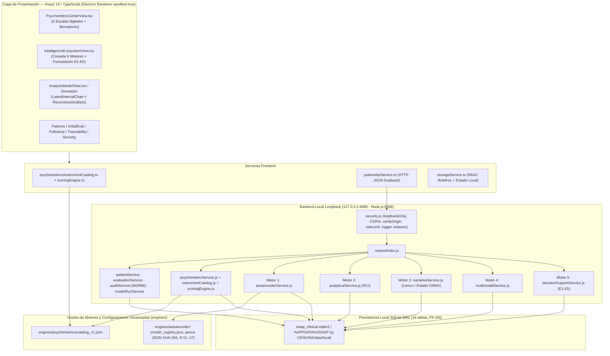
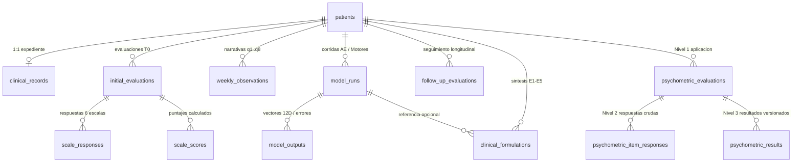
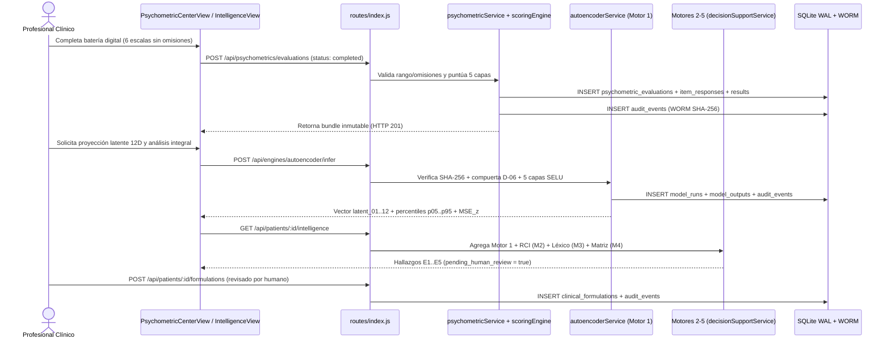

# Arquitectura de Software — SISAP by CENIVRA v1.1

## Control Documental

| Campo | Valor |
|---|---|
| **Código documental** | `SISAP-LC-005` |
| **Título** | Descripción Arquitectónica de Software (SAD) conforme a IEC 62304 §5.3 |
| **Versión** | `1.1.0-draft` |
| **Estado** | **En revisión** |
| **Fecha de creación** | 2026-11-23 |
| **Última actualización** | 2026-11-23 |
| **Autor / Responsable** | Responsable de Arquitectura de Software — SISAP by CENIVRA |
| **Revisor y aprobación** | **Pendiente de revisión formal** |
| **Documentos relacionados** | `SISAP-LC-001` · `SISAP-LC-003` · `SISAP-LC-004` · `SISAP-LC-006` · `docs/modules/*` |

### Historial de Cambios

| Versión | Fecha | Descripción | Responsable |
|---|---|---|---|
| `1.1.0-draft` | 2026-11-23 | Documentación arquitectónica completa del sistema real en producción/desarrollo `v1.1.0`: Electron v45 (NSIS + Portable `.exe`, puerto loopback dinámico, IPC de respaldos en `%APPDATA%`), React 19 + TS (Estación de Trabajo técnica y cinta contextual `WorkbenchContextRibbon`), Backend Node.js ESM (`127.0.0.1`), SQLite WAL (16 tablas, migración `004` con `model_governance_registry` y trazabilidad de 8 campos), Motores 1..5, Centro Psicométrico, separación Modo Institucional vs Evaluación y diagramas actualizados. | Equipo de Ingeniería SISAP |

---

## 1. Arquitectura General y Capas de SISAP `v1.1.0`

SISAP sigue una arquitectura local desacoplada orientada a privacidad (*local-first*), con aislamiento estricto de procesos en escritorio (**Electron v45**), interfaz clínica en **React 19 + TypeScript 7**, servidor HTTP local restringido a loopback (**Node.js ESM >=22.5 + Express 4.22 / `node:http`**), motores científicos puros sin estado en `engines/` y persistencia relacional **SQLite en modo WAL** mediante `node:sqlite`.

### Diagrama 1: Arquitectura de Componentes (`flowchart`)



---

## 2. Diagrama de Despliegue y Fronteras de Confianza

```mermaid
flowchart LR
  USER["Profesional Clínico / Admin\n(Windows 10/11 o Sesión Local)"] --> ELEC["Proceso Principal Electron v45\n(SingleInstanceLock · main.cjs)"]
  ELEC -->|"BrowserWindow: contextIsolation=true\nnodeIntegration=false · sandbox=true"| RENDERER["SPA Vite React\n(http://127.0.0.1:8080 o dist/)"]
  ELEC -->|"Arranca embebido / healthcheck"| NODE["Servidor Local Node.js\n127.0.0.1:8080 (loopbackOnly)"]
  NODE -->|"node:sqlite WAL + FK ON"| SQLITE[("SQLite Local\n(%APPDATA% o data/local)")]
  NODE -->|"Lectura SHA-256 verificada"| ENG["engines/ (autoencoder + psychometrics)"]
  DEV["Entorno Científico Opcional (R >=4.0)"] -.->|"Verificación offline / CLI\n(Rscript test_*.R)" .-> ENG
```

### Fronteras de Confianza y Seguridad
1. **Frontera 1 (Red externa → Proceso local):** El socket HTTP acepta **únicamente direcciones loopback (`127.0.0.1`, `::1`, `::ffff:127.0.0.1`)**. Cualquier conexión externa es bloqueada antes de enrutar (`RSK-008`).
2. **Frontera 2 (Renderer Web/React → Sistema operativo):** `electron/main.cjs` fuerza `contextIsolation: true`, `nodeIntegration: false` y `sandbox: true`, bloqueando navegación externa y exposición de APIs de sistema de archivos.
3. **Frontera 3 (Datos clínicos → Logs / Repositorio / IA):** `logger.js` enmascara claves sensibles (`[REDACTED]`), `audit_events` bloquea `UPDATE`/`DELETE` por triggers SQL con cadena de hash SHA-256, y ninguna salida del Motor 1 o Motor 5 puede emitir diagnósticos ni prescripciones automáticas.

---

## 3. Modelo de Datos y Persistencia (SQLite WAL — 16 Tablas en 4 Migraciones)

Las migraciones son estrictamente aditivas:
- **`001_initial_schema.sql` (10 tablas núcleo `v1.0.0`):** `schema_migrations`, `patients`, `clinical_records`, `initial_evaluations`, `scale_responses`, `scale_scores`, `weekly_observations`, `model_runs`, `model_outputs`, `audit_events`.
- **`002_intelligence_engines.sql` (+2 tablas):** `follow_up_evaluations`, `clinical_formulations`.
- **`003_psychometric_center.sql` (+3 tablas en 3 niveles):** `psychometric_evaluations`, `psychometric_item_responses`, `psychometric_results`.
- **`004_model_governance_and_traceability.sql` (+1 tabla y +5 columnas auditables):** `model_governance_registry` (sembrado de `encoder_22_checkpoint_fase2` como `ACTIVE_DEFAULT`) y extensión de `model_runs` con `model_id`, `artifact_sha256`, `input_schema_version`, `executed_by`, `actor_role`.

### Diagrama 3: Modelo Entidad-Relación (`erDiagram`)



---

## 4. Responsabilidades, Límites de Cada Motor e Interfaces REST

### Contratos de Rutas en `backend/src/routes/index.js`

| Dominio | Rutas HTTP (`127.0.0.1:8080`) | Servicio / Motor Responsable | Restricción / Validación Clave |
|---|---|---|---|
| **Salud y Migraciones** | `GET /api/health`, `GET /api/migrations/status` | `db/index.js` | Verifica 16 tablas, `PRAGMA foreign_keys = ON`, `service: 'sisap-local-backend'` y migraciones `1..4`. |
| **Pacientes y Expediente** | `GET /api/patients/search`, `GET /api/patients/duplicates`, `GET /api/patients/:id/record`, `POST /api/patients` | `patientService.js` | Consultas parametrizadas; `allow_duplicate` explícito en colisión nombre/CURP. |
| **Evaluación Base y Semanal** | `POST /api/evaluations`, `POST /api/weekly-observations` | `evaluationService.js` | Transacción atómica; registro WORM automático. |
| **Centro Psicométrico** | `GET /api/psychometrics/catalog`, `POST /api/psychometrics/score`, `POST /api/psychometrics/evaluations`, `GET /api/patients/:id/psychometrics`, `GET /api/psychometrics/evaluations/:id`, `POST /api/psychometrics/evaluations/:id/recalculate` | `instrumentCatalog.js`, `scoringEngine.js`, `psychometricService.js` | Excluye `OCI-R`; bloquea sobrescritura `completed` con `HTTP 409`; detecta `versionMismatchWarning`. |
| **Motor 1 (Autoencoder y Gobernanza)** | `GET /api/engines/autoencoder/reference`, `GET /api/engines/autoencoder/governance`, `POST /api/engines/autoencoder/governance/active-model`, `POST /api/engines/autoencoder/infer`, `POST /api/engines/autoencoder/candidate17/infer` | `autoencoderService.js`, `autoencoderInferenceEngine.js` | Valida SHA-256 sin fallback; compuerta `D-06` (`HTTP 422`); bloquea con `HTTP 403` cambios o overrides no administrativos; persiste 8 campos de trazabilidad en `model_runs`. |
| **Motores 2..5 (Ecosistema)** | `GET /api/engines/status`, `POST /api/follow-ups`, `GET /api/patients/:id/follow-ups`, `GET /api/patients/:id/intelligence`, `POST /api/patients/:id/formulations` | `analyticalService`, `narrativeService`, `multimodalService`, `decisionSupportService` | `automatic_diagnosis_disabled = true`, `pending_human_review` obligatorio, `inference_ready: false` en ONNX ausente. |
| **Auditoría WORM** | `GET /api/audit/events`, `GET /api/audit/verify`, `GET/POST /api/model-runs` | `auditService.js`, `modelRunService.js` | Cadena SHA-256 verificable + triggers `BEFORE UPDATE/DELETE`. |

---

## 5. Diagrama 4: Secuencia de Captura Psicométrica, Inferencia y Síntesis E1–E5 (`sequenceDiagram`)



---

## 6. Control de Acceso (RBAC) y Estrategia de Mantenimiento/Escalabilidad

1. **Roles definidos en `RoleKey` (`src/types/clinical.ts`):**
   - `superadmin`, `admin`, `director_clinico`, `psicologo`, `medicina`, `enfermeria`, `consejero`, `trabajador_social`, `coordinacion`, `viewer`.
   - Controlan en el cliente qué usuarios visualizan identidad (`ve_identidad`), reidentifican (`reidentifica`), escriben (`escribe`), ejecutan modelos (`usa_modelo`), acceden a administración (`administra`) o capa blindada (`capa_blindada`).
   - *Brecha declarada para evolución multiusuario:* actualmente el backend atiende sesiones locales monousuario en loopback sin exigir verificación criptográfica por token JWT por ruta; si SISAP evoluciona a despliegue en servidor institucional multiusuario en red, deberá implementarse autenticación/autorización por token en middleware del backend (trazado en `REQ-SEC-004` como `Parcial`).
2. **Escalabilidad y Mantenibilidad:**
   - Catálogo psicométrico externo JSON (`catalog_v1.json`) que permite versionar escalas o agregar ediciones autorizadas sin alterar componentes React.
   - Registro declarativo de modelos (`model_registry.json`) que permite auditar nuevas variantes por hash sin mezclar pesos experimentales con el modelo productivo `encoder_22_checkpoint_fase2`.
   - Separación limpia entre vistas UI, servicios HTTP, lógica estadística pura e infraestructura SQLite WAL.
