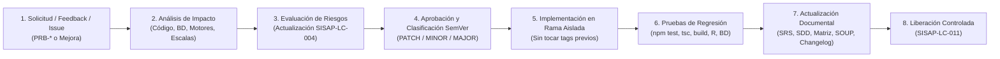

# Procedimiento de Mantenimiento y Control de Cambios — SISAP

## Control Documental

| Campo | Valor |
|---|---|
| **Código documental** | `SISAP-LC-012` |
| **Título** | Procedimiento de Mantenimiento de Software y Gestión de Cambios (IEC 62304 §6) |
| **Versión** | `1.1.0-draft` |
| **Estado** | **En revisión** |
| **Fecha de creación** | 2026-11-23 |
| **Última actualización** | 2026-11-23 |
| **Autor / Responsable** | Equipo de Ingeniería y Mantenimiento — SISAP by CENIVRA |
| **Revisor y aprobación** | **Pendiente de revisión formal** |
| **Documentos relacionados** | `SISAP-LC-002` · `SISAP-LC-004` · `SISAP-LC-013` · `SISAP-LC-014` · `SISAP-LC-018` |

### Historial de Cambios

| Versión | Fecha | Descripción | Responsable |
|---|---|---|---|
| `1.1.0-draft` | 2026-11-23 | Formalización del proceso de mantenimiento IEC 62304 Cláusula 6 para la línea `v1.1.x` en adelante. | Equipo de Ingeniería SISAP |

---

## 1. Propósito y Alcance
Establece las actividades obligatorias tras la liberación de una versión de SISAP (ej. preservando `v1.0.0` y gestionando evolución sobre `release/1.1.0` o futuras ramas `release/x.y.z`) conforme a **IEC 62304 §6.1–6.3**.

---

## 2. Flujo Obligatorio por Solicitud de Cambio

### Reglas Operativas por Etapa
1. **Solicitud de cambio:** Registrar en Issue de GitHub o entrada en `SISAP-LC-018` identificando componente, versión afectada y justificación clínica/técnica.
2. **Análisis de impacto:** Determinar si afecta contratos REST, esquema SQLite (exige migración aditiva numerada `004+`), catálogo psicométrico (exige nueva versión de instrumento o `algorithm_version`), pesos Autoencoder (exige re-cálculo SHA-256 en `model_registry.json`) o dependencias SOUP (`package-lock.json` / `SISAP-LC-016`).
3. **Evaluación de riesgos:** Revisar si introduce un nuevo peligro o altera un control existente en `SISAP-LC-004`; todo riesgo nuevo o modificado exige prueba de verificación asociada.
4. **Aprobación:** Decidir incremento SemVer (`PATCH`, `MINOR` o `MAJOR` si rompe compatibilidad con versiones previas de BD/API).
5. **Implementación:** Desarrollar en rama separada preservando intactos los tags históricos (`v1.0.0`).
6. **Pruebas de regresión:** Re-ejecutar obligatoriamente `npm test`, `npm run lint`, `npm run build`, pruebas de migración aditiva sobre BD anterior y suites R si toca `engines/autoencoder/`.
7. **Actualización documental:** Actualizar SRS, diseño modular, matriz bidireccional, changelog y notas de versión antes de aprobar la liberación.
8. **Liberación:** Emitir expediente de liberación (`SISAP-LC-011`) y actualizar línea base (`SISAP-LC-014`).
